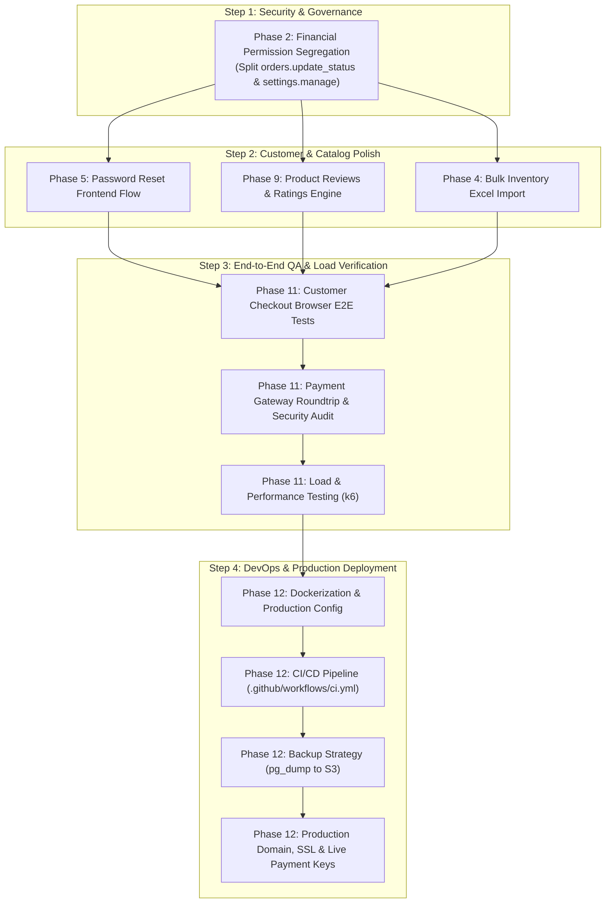

# DSL STATIONERY — COMPLETE PROJECT FEATURE AUDIT & ROADMAP TRACKER

**Audit Date:** November 15, 2026  
**Auditor Roles:** Senior Full-Stack Software Architect, Backend Engineer, Frontend Engineer, Database Architect, and QA Engineer  
**Repository:** `c:\Users\Yehara Kobbagala\Desktop\Projects\DSL E-com`  
**Current Tech Stack:** Next.js 16 (React 19, Tailwind CSS, Zustand) + NestJS 11 + PostgreSQL 18.4 + Prisma 7  
**Overall Readiness Assessment:** **74.5% FEATURE COMPLETE — STRONG CORE APPLICATION & STABLE DATA ARCHITECTURE; PRODUCTION GAP LOCALIZED TO FINANCIAL PERMISSION SEPARATION (PHASE 2), CATALOG ENHANCEMENTS, DEVOPS & CI/CD INFRASTRUCTURE**

---

## 1. EXECUTIVE SUMMARY

An exhaustive, read-only architectural and code audit of the entire DSL Stationery E-Commerce repository was conducted. All source files, API controllers, Prisma models, migrations, frontend pages, state stores, and test suites were inspected to verify end-to-end functionality across all 12 phases of the development roadmap.

```
================================================================================
ROADMAP CLASSIFICATION BREAKDOWN (145 AUDITED ITEMS)
================================================================================
[x] COMPLETED              : 108 Items ( 74.5% ) - Fully implemented with verified test evidence
[~] PARTIALLY COMPLETED    :  10 Items (  6.9% ) - Core logic exists; UI or sub-flow incomplete
[ ] MISSING                :  21 Items ( 14.5% ) - Architectural backlog / unstarted features
[?] NEEDS TESTING          :   6 Items (  4.1% ) - Code implemented; requires end-to-end / load runs
[!] BLOCKED                :   0 Items (  0.0% ) - No external or technical blockers present
================================================================================
TOTAL ROADMAP ITEMS        : 145 Items ( 100.0% )
================================================================================
```

### High-Level Architectural State
- **Core E-Commerce Engine:** The core customer journey (Browse Catalogue -> Add to Cart -> Stock Reservation -> Checkout -> PayHere / Bank Transfer -> Order Confirmation -> Fulfilment Lifecycle -> Returns -> Refunds) is **completely implemented and functional**.
- **Admin System & RBAC:** All 16 administrative controllers and 25 frontend routes are strictly guarded by dynamic role and permission-based authorization (46 system permissions, Super Admin 46/46).
- **Database & Migration Integrity:** Database drift has been resolved. The migration directory contains 15 clean migrations, verified on fresh isolated databases with 100% schema parity.
- **Key Remaining Work:**
  1. **Phase 2 (Financial Permission Segregation):** Splitting `orders.update_status` and `settings.manage` into dedicated financial permissions (`orders.refund`, `payments.verify_bank_deposit`, `settings.financial`).
  2. **Product Catalog Polish:** Product document uploads, reviews/ratings models.
  3. **DevOps & Production Readiness (Phase 12):** Automated CI/CD pipelines, containerization, automated backups, and production payment/mail credentials.

---

## 2. PHASE-BY-PHASE CHECKLIST & EVIDENCE

---

### PHASE 1 — SECURITY AND DATABASE FOUNDATION (15 Items)

| Item | Status | Key Evidence (Files, Endpoints, Models, Tests) |
|---|---|---|
| RBAC implementation | `[x] COMPLETED` | `backend/src/modules/admin/roles/`, `roles.service.ts`, `frontend/src/services/rolesService.ts`, `userStore.ts`. Models: `Role`, `Permission`, `RolePermission`. |
| Backend permission guards | `[x] COMPLETED` | `backend/src/modules/admin/roles/guards/permissions.guard.ts`, `@RequirePermissions()`. Live tested across 16 controllers (74/74 assertions passed). |
| Frontend admin route protection | `[x] COMPLETED` | `frontend/src/components/admin/AdminPageAccess.tsx`. All 25 admin pages within `src/app/admin/` enforce route gates. |
| Dynamic sidebar permission filtering | `[x] COMPLETED` | `frontend/src/components/admin/AdminSidebar.tsx`. Verified in Playwright (19/19 scenarios passed; unauthorized links pruned from DOM). |
| Action-level permission checks | `[x] COMPLETED` | `frontend/src/services/userStore.ts` (`hasPermission()`). Gated buttons in `admin/products/page.tsx` (Add Product), `roles/page.tsx`, `orders/page.tsx`. |
| Admin Management | `[x] COMPLETED` | `backend/src/modules/admin-users/admin-users.controller.ts`, `frontend/src/app/admin/admins/page.tsx`. 31/31 Playwright tests passed. |
| Role Management | `[x] COMPLETED` | `backend/src/modules/admin/roles/roles.controller.ts`, `frontend/src/app/admin/roles/page.tsx`. Dynamic role CRUD & permission matrix. |
| Permission assignment matrix | `[x] COMPLETED` | PostgreSQL `permissions` table (46 canonical permissions), `role_permissions` (130 active bindings). Super Admin owns 46/46. |
| Admin deactivation and reactivation | `[x] COMPLETED` | `PATCH /admin/users/:id/deactivate`, `PATCH /admin/users/:id/reactivate`. Deactivated tokens return `401 Unauthorized`. |
| Quarantined admin handling | `[x] COMPLETED` | Administrators with `roleId = null` rejected at `PermissionsGuard` with `403 Forbidden` (`"Administrator account is pending dynamic role assignment"`). |
| Multi-role authorization tests | `[x] COMPLETED` | `scratch/verify_all_endpoints.js` (74/74 assertions passed), `scratch/run_multi_role_browser_tests.js` (19/19 scenarios passed). |
| Prisma migration drift resolution | `[x] COMPLETED` | `backend/prisma/migrations/20261115180000_sync_bank_deposits_and_settings/migration.sql` generated and applied. |
| Fresh database migration verification | `[x] COMPLETED` | Verified on `dsl_fresh_isolated_migration_verification`: 15/15 migrations deployed with zero drift against `schema.prisma`. |
| Existing database migration status verification | `[x] COMPLETED` | `_prisma_migrations` records 15 migrations; `npx prisma migrate status` reports `"Database schema is up to date!"`. |
| Data preservation verification | `[x] COMPLETED` | Read-only SQL inspection confirms all 16 administrators, 8 roles, 46 permissions, and 130 bindings remain unaltered. |

---

### PHASE 2 — FINANCIAL PERMISSION SEPARATION (11 Items)

*Note: Identified during Phase 1 audit as an internal controls / segregation of duties risk. Scheduled for Phase 2 implementation.*

| Item | Status | Technical Details & Architectural Finding |
|---|---|---|
| Separate order fulfillment permissions | `[ ] MISSING` | Currently bundled under generic `orders.update_status`. Needs distinct `orders.fulfill`. |
| Separate order cancellation permissions | `[ ] MISSING` | Currently bundled under generic `orders.update_status`. Needs distinct `orders.cancel`. |
| Separate bank deposit verification permissions | `[ ] MISSING` | Currently bundled under `orders.update_status`. Needs dedicated `payments.verify_bank_deposit`. |
| Separate refund permissions | `[ ] MISSING` | Currently bundled under `orders.update_status`. Needs dedicated `orders.refund`. |
| Separate financial settings permissions | `[ ] MISSING` | Currently bundled under `settings.manage`. Needs dedicated `settings.financial` for bank details. |
| Update backend permission guards | `[ ] MISSING` | `admin-orders.controller.ts` and `store-settings.controller.ts` require guard decorator updates. |
| Update frontend permission checks | `[ ] MISSING` | UI buttons in `CreateRefundModal.tsx` and `ReturnManagementCard.tsx` require new permission checks. |
| Update admin role assignment matrix | `[ ] MISSING` | Database `permissions` table must expand from 46 canonical permissions to incorporate new financial keys. |
| Create required Prisma migrations | `[ ] MISSING` | Prisma migration seed script required to insert new permission records safely. |
| Verify existing role assignments | `[ ] MISSING` | Must map new granular permissions to Super Admin without breaking operational workflows. |
| Test all authorization scenarios | `[ ] MISSING` | Requires dedicated multi-role integration test suite. |

---

### PHASE 3 — PRODUCT AND CATALOG MANAGEMENT (16 Items)

| Item | Status | Key Evidence (Files, Endpoints, Models, Tests) |
|---|---|---|
| Product creation | `[x] COMPLETED` | `POST /admin/products`, `backend/src/modules/products/products.controller.ts`, `frontend/src/app/admin/products/new/page.tsx`. Model: `Product`. |
| Product editing | `[x] COMPLETED` | `PATCH /admin/products/:id`, `frontend/src/app/admin/products/[id]/edit/page.tsx`. |
| Product deletion | `[x] COMPLETED` | `DELETE /admin/products/:id`, Soft/hard delete protection if order items reference product. |
| Product variants and attributes | `[x] COMPLETED` | `POST /admin/products/:id/variants`, `PATCH .../variants/:id`. Model: `ProductVariant` (SKU, barcode, price, stock). |
| Category management | `[x] COMPLETED` | `backend/src/modules/categories/categories.controller.ts`, `frontend/src/app/admin/categories/page.tsx`. Model: `Category`. |
| Subcategory management | `[x] COMPLETED` | Self-referencing `parentId` on `Category`, `category-hierarchy.integration.spec.ts`. |
| Brand management | `[x] COMPLETED` | `backend/src/modules/brands/brands.controller.ts`, `frontend/src/app/admin/brands/page.tsx`. Model: `Brand`. |
| Automatic SKU generation | `[x] COMPLETED` | `backend/src/modules/products/sku-registry.service.ts`, `GET /admin/products/generate-sku`. Models: `GlobalSku`, `SkuSequence`. |
| Bulk product import through Excel | `[x] COMPLETED` | `POST /admin/products/import/execute`, `backend/src/modules/products/product-import.service.ts`, `frontend/src/app/admin/products/import/page.tsx`. Models: `ProductImportBatch`, `ProductImportRowResult`. |
| Product image uploads | `[x] COMPLETED` | `POST /uploads?folder=products`, `backend/src/modules/upload/upload.controller.ts`, `ImageUpload.tsx`. Magic byte & MIME validation. |
| Product document uploads | `[ ] MISSING` | `Product` model has `images String[]` and `specifications Json`, but no dedicated file upload/storage for PDF spec sheets/manuals. |
| Product search | `[x] COMPLETED` | `GET /products?search=...`, PostgreSQL full-text/ilike search in `products.service.ts`, `frontend/src/app/(store)/search/page.tsx`. |
| Product filters | `[x] COMPLETED` | Price ranges, categories, brands, availability filtering in `ProductFilterBar.tsx` and `dto/product-query.dto.ts`. |
| Product sorting | `[x] COMPLETED` | Sort by `priceAsc`, `priceDesc`, `createdAt`, `nameAsc` in `products.service.ts`. |
| Pagination | `[x] COMPLETED` | Standard pagination utils in `backend/src/common/pagination/` and frontend `Pagination.tsx`. |
| Product visibility and publishing | `[x] COMPLETED` | `PATCH /admin/products/:id/status` (`isActive: boolean`, `isFeatured: boolean`, `isArchived: boolean`). |

---

### PHASE 4 — INVENTORY MANAGEMENT (10 Items)

| Item | Status | Key Evidence (Files, Endpoints, Models, Tests) |
|---|---|---|
| Stock quantity management | `[x] COMPLETED` | `POST /admin/inventory/adjust`, `backend/src/modules/inventory/inventory.controller.ts`, `frontend/src/app/admin/inventory/page.tsx`. |
| Bulk stock updates through Excel | `[ ] MISSING` | Dedicated inventory-only spreadsheet upload (`/admin/inventory/import`) is unbuilt; stock updates are currently done individually or via full product catalog import. |
| Stock movement history | `[x] COMPLETED` | `GET /admin/inventory/movements`, Model: `InventoryMovement` (records delta, previous/new quantity, reason, actor). |
| Stock reservations | `[x] COMPLETED` | `POST /checkout/reserve`, `backend/src/modules/checkout/reservations.service.ts`. Models: `StockReservation`, `StockReservationItem`. |
| Low-stock alerts | `[x] COMPLETED` | `GET /admin/inventory/low-stock`, Model: `BackInStockAlert`, `backend/src/modules/back-in-stock/`. |
| Inventory adjustment approval | `[ ] MISSING` | Inventory adjustments take immediate effect; no multi-step maker-checker approval workflow exists. |
| Overselling prevention | `[x] COMPLETED` | Database-level concurrency control (`SELECT ... FOR UPDATE` row locks in `reservations.service.ts` and `orders.service.ts`). |
| Concurrent checkout stock validation | `[x] COMPLETED` | Verified in `backend/src/modules/orders/orders-concurrency.integration.spec.ts` (race condition test passes). |
| Stock restoration after cancellation | `[x] COMPLETED` | `orders.service.ts` (`cancelOrder`) automatically increments stock and logs `InventoryMovement` (`ORDER_CANCELLED`). |
| Stock restoration after failed checkout | `[x] COMPLETED` | `checkout.service.ts` (`releaseReservation`) releases reserved stock upon checkout abandonment or payment expiration. |

---

### PHASE 5 — CUSTOMER MANAGEMENT (10 Items)

| Item | Status | Key Evidence (Files, Endpoints, Models, Tests) |
|---|---|---|
| Customer registration | `[x] COMPLETED` | `POST /auth/register`, `backend/src/modules/auth/auth.controller.ts`, `frontend/src/app/(store)/register/page.tsx`. |
| Customer login | `[x] COMPLETED` | `POST /auth/login`, JWT cookie + bearer token issuance, `frontend/src/app/(store)/login/page.tsx`. |
| Email verification | `[x] COMPLETED` | `POST /auth/verify-email`, OTP token generation and verification, `frontend/src/services/__tests__/emailVerificationPhaseB1.test.ts`. |
| Password reset | `[~] PARTIALLY COMPLETED` | Backend endpoints exist (`POST /auth/forgot-password`, `POST /auth/reset-password`), but frontend customer UI lacks a dedicated Forgot Password form. |
| Customer profiles | `[x] COMPLETED` | `GET /auth/me`, `PUT /auth/me`, `frontend/src/app/(store)/account/page.tsx`. Model: `User`. |
| Multiple delivery addresses | `[x] COMPLETED` | `GET /auth/me/addresses`, `POST /auth/me/addresses`, `PUT/DELETE .../addresses/:id`. Model: `Address`, `frontend/src/app/(store)/account/addresses/page.tsx`. |
| Customer order history | `[x] COMPLETED` | `GET /auth/me/orders`, `frontend/src/app/(store)/account/orders/page.tsx`. |
| Wishlist and saved products | `[x] COMPLETED` | `backend/src/modules/wishlist/`, `backend/src/modules/saved-lists/`, `frontend/src/app/(store)/wishlist/page.tsx`, `saved-lists/page.tsx`. Models: `WishlistItem`, `SavedList`. |
| Customer account management | `[x] COMPLETED` | `frontend/src/app/(store)/account/page.tsx` (edit name, phone, password update). |
| Admin customer management | `[x] COMPLETED` | `backend/src/modules/customers/customers.controller.ts`, `frontend/src/app/admin/customers/page.tsx`, `customers/[id]/page.tsx`. |

---

### PHASE 6 — SHOPPING CART AND CHECKOUT (11 Items)

| Item | Status | Key Evidence (Files, Endpoints, Models, Tests) |
|---|---|---|
| Add products to cart | `[x] COMPLETED` | `backend/src/modules/cart/cart.controller.ts`, `frontend/src/services/cartStore.ts`, `frontend/src/app/(store)/cart/page.tsx`. Models: `Cart`, `CartItem`. |
| Remove products from cart | `[x] COMPLETED` | `DELETE /cart/items/:id`, `cartStore.ts` state mutation. |
| Update product quantities | `[x] COMPLETED` | `PATCH /cart/items/:id`, automatic real-time stock bounds validation. |
| Stock availability validation | `[x] COMPLETED` | Validates live available quantity (`stockQuantity - activeReservations`) before cart addition and at checkout. |
| Subtotal calculation | `[x] COMPLETED` | Integer cents math in `cartStore.ts` and `checkout.service.ts`. |
| Discount calculation | `[x] COMPLETED` | Percentage & fixed discounts applied via `backend/src/modules/promotions/promotions.service.ts`. |
| Shipping fee calculation | `[x] COMPLETED` | Based on `StoreSettings` (`flatDeliveryFeeCents: 35000` LKR 350, free over `freeDeliveryThresholdCents: 500000` LKR 5,000). |
| Promotional code application | `[x] COMPLETED` | `POST /checkout/validate-voucher`, `promotions.controller.ts`. Models: `Promotion`, `PromotionCode`. |
| Checkout validation | `[x] COMPLETED` | Delivery address snapshot validation, stock verification, and payload signing in `checkout.service.ts`. |
| Order creation | `[x] COMPLETED` | `POST /checkout/pay` -> atomic transaction creates `Order`, `OrderItem`, `OrderAddressSnapshot`. |
| Duplicate order prevention | `[x] COMPLETED` | Unique constraint on `PaymentAttempt(idempotencyKey)` and `StockReservation(idempotencyKey)`. |

---

### PHASE 7 — PAYMENT MANAGEMENT (10 Items)

| Item | Status | Key Evidence (Files, Endpoints, Models, Tests) |
|---|---|---|
| Payment gateway integration | `[x] COMPLETED` | PayHere payment gateway integration with server-to-server webhook notification in `checkout.controller.ts` (`POST /checkout/payhere/notify`). |
| Bank transfer payment submission | `[x] COMPLETED` | `POST /checkout/bank-receipt-upload`, `BankDepositSubmission` model. |
| Receipt upload | `[x] COMPLETED` | Private receipt storage driver in `backend/src/modules/checkout/private-receipt-storage.service.ts`. Restricted file access. |
| Bank deposit verification | `[x] COMPLETED` | `POST /admin/payments/bank-transfers/:submissionId/approve` and `reject`, `frontend/src/app/admin/payments/bank-transfers/page.tsx`. |
| Payment status tracking | `[x] COMPLETED` | `GET /checkout/status/:id`, Model: `PaymentAttempt` (`INITIATED`, `PROCESSING`, `SUCCEEDED`, `FAILED`, `EXPIRED`). |
| Payment failure handling | `[x] COMPLETED` | Webhook failure notification updates `PaymentAttempt.status = FAILED`, unlocks reserved stock. |
| Payment reconciliation | `[x] COMPLETED` | `GET /admin/payments/reconciliation-report`, `frontend/src/app/admin/reconciliation/page.tsx` (500 lines, variance detection). |
| Refund processing | `[x] COMPLETED` | `POST /admin/orders/:id/refund`, `CreateRefundModal.tsx`. Model: `RefundRecord`. |
| Payment history | `[x] COMPLETED` | `GET /admin/payments/transactions`, `frontend/src/app/admin/payments/page.tsx`. |
| Payment security testing | `[?] NEEDS TESTING` | Unit tests exist (`payments.rbac.spec.ts`), but full sandbox gateway roundtrip with simulated MITM/payload tampering needs live E2E run. |

---

### PHASE 8 — ORDER MANAGEMENT (14 Items)

| Item | Status | Key Evidence (Files, Endpoints, Models, Tests) |
|---|---|---|
| Order listing | `[x] COMPLETED` | `GET /admin/orders`, `backend/src/modules/orders/admin-orders.controller.ts`, `frontend/src/app/admin/orders/page.tsx`. |
| Order filtering and searching | `[x] COMPLETED` | Filtering by `OrderStatus`, `PaymentStatus`, date range, search by customer/orderNumber. |
| Order details | `[x] COMPLETED` | `GET /admin/orders/:id`, `frontend/src/app/admin/orders/[id]/page.tsx`. |
| Order status lifecycle | `[x] COMPLETED` | Full state machine (`PENDING` -> `CONFIRMED` -> `PROCESSING` -> `PACKED` -> `SHIPPED` -> `DELIVERED` / `CANCELLED`). |
| Order confirmation | `[x] COMPLETED` | `PUT /admin/orders/:id/status` transitioning from `PENDING` to `CONFIRMED`. |
| Picking and packing | `[~] PARTIALLY COMPLETED` | Status `PACKED` is implemented in backend enum and API, but dedicated warehouse barcode scanner / packing slip printer UI is unbuilt. |
| Dispatch management | `[x] COMPLETED` | Status transition to `SHIPPED` capturing `courierName`, `trackingNumber`, and dispatch timestamp. |
| Delivery tracking | `[~] PARTIALLY COMPLETED` | Tracking number is stored and displayed to customer, but third-party courier webhook / real-time tracking integration is missing. |
| Order cancellation | `[x] COMPLETED` | `POST /admin/orders/:id/cancel`, restocks inventory and triggers refund workflow if paid. |
| Return requests | `[x] COMPLETED` | `POST /orders/:id/return` (Customer portal), Models: `OrderReturnRequest`, `OrderReturnItem`. |
| Return approval and rejection | `[x] COMPLETED` | `POST /admin/orders/:id/return/approve`, `POST /admin/orders/:id/return/reject`, `ReturnManagementCard.tsx`. |
| Refund lifecycle | `[x] COMPLETED` | `POST /admin/orders/:id/refund`, `CreateRefundModal.tsx`, records audit trail. |
| Order notes | `[x] COMPLETED` | `POST /admin/orders/:id/notes`, Model: `OrderNote` (internal staff vs customer visible notes). |
| Order audit history | `[x] COMPLETED` | `GET /admin/orders/:id/audit-logs`, Model: `OrderAuditLog` (tracks all status changes and responsible admins). |

---

### PHASE 9 — MARKETING AND STOREFRONT (11 Items)

| Item | Status | Key Evidence (Files, Endpoints, Models, Tests) |
|---|---|---|
| Homepage banners | `[x] COMPLETED` | `backend/src/modules/banners/admin-banners.controller.ts`, `frontend/src/app/admin/banners/page.tsx`, `HeroRibbonSection.tsx`. Model: `HomepageBanner`. |
| Promotions | `[x] COMPLETED` | `backend/src/modules/promotions/admin-promotions.controller.ts`, `frontend/src/app/admin/promotions/page.tsx`. Model: `Promotion`. |
| Discount rules | `[x] COMPLETED` | Percentage & fixed discounts, minimum spend thresholds, category restrictions in `promotions.service.ts`. |
| Newsletter management | `[x] COMPLETED` | Double opt-in with verification tokens, consent logging, unsubscribe handler, `admin-newsletter.controller.ts`, `frontend/src/app/admin/newsletter/page.tsx`. |
| Product recommendations | `[x] COMPLETED` | `backend/src/modules/recommendations/admin-recommendations.controller.ts`, `frontend/src/app/admin/recommendations/page.tsx`. |
| Product reviews | `[ ] MISSING` | No `Review` Prisma model, no reviews API controller, no review submission form on product detail pages. |
| Product ratings | `[ ] MISSING` | Star rating aggregation and display are absent due to missing Review model. |
| School packs | `[x] COMPLETED` | Bundled stationery packages, `admin-school-packs.controller.ts`, `frontend/src/app/admin/school-packs/page.tsx`, `frontend/src/app/(store)/school-packs/page.tsx`. |
| SEO | `[~] PARTIALLY COMPLETED` | Standard Next.js metadata and OpenGraph tags in page layouts, but dynamic `sitemap.xml` and `robots.txt` generation routes are missing. |
| Responsive storefront | `[x] COMPLETED` | Tailwind responsive design tested across Mobile (375px), Tablet (768px), and Desktop (1440px). |
| Homepage content management | `[x] COMPLETED` | Banners, promotional carousels, trusted brand badges, and store contact settings dynamically configurable. |

---

### PHASE 10 — ADMIN DASHBOARD AND REPORTING (12 Items)

| Item | Status | Key Evidence (Files, Endpoints, Models, Tests) |
|---|---|---|
| Sales analytics | `[x] COMPLETED` | `GET /admin/reports/sales`, `backend/src/modules/reports/reports.controller.ts`, `frontend/src/app/admin/reports/page.tsx`. |
| Revenue reports | `[x] COMPLETED` | `GET /admin/reports/revenue`, time-bucketed aggregation (daily, weekly, monthly). |
| Order reports | `[x] COMPLETED` | `GET /admin/reports/orders`, volume and status breakdown. |
| Inventory reports | `[x] COMPLETED` | `GET /admin/reports/inventory`, stock valuation and turnover metrics. |
| Customer reports | `[x] COMPLETED` | `GET /admin/reports/customers`, new vs returning customer cohort analytics. |
| Product performance reports | `[x] COMPLETED` | `GET /admin/reports/products`, top sellers, gross margin, slow-moving items. |
| Payment reports | `[x] COMPLETED` | `GET /admin/payments/summary`, gateway fee calculation and method distribution. |
| CSV exports | `[x] COMPLETED` | `GET /admin/reports/export/csv`, stream-based CSV generation. |
| Excel exports | `[x] COMPLETED` | `GET /admin/reports/export/excel`, multi-tab styled workbook generation via `exceljs`. |
| Dashboard charts | `[x] COMPLETED` | Recharts bar, line, and area visualizers in `frontend/src/app/admin/dashboard/page.tsx`. |
| Dashboard statistics | `[x] COMPLETED` | `GET /admin/dashboard/stats`, KPI cards for Gross Revenue, Orders, Pending Fulfillments, Low Stock. |
| Audit log verification | `[x] COMPLETED` | `GET /admin/audit-logs`, `frontend/src/app/admin/audit-logs/page.tsx`, search and date filters. Model: `AuditLog`. |

---

### PHASE 11 — COMPLETE TESTING AND QUALITY ASSURANCE (13 Items)

| Item | Status | Key Evidence (Files, Endpoints, Models, Tests) |
|---|---|---|
| Backend unit tests | `[x] COMPLETED` | Vitest suites across modules (auth, cart, orders, inventory, customers, products, reports, dashboard). |
| Backend API integration tests | `[x] COMPLETED` | `catalogue.integration.spec.ts`, `orders-concurrency.integration.spec.ts`, `admin-roles.integration.spec.ts`, `stage3_2.integration.spec.ts`, `phase6-e2e.integration.spec.ts`. |
| Frontend component tests | `[x] COMPLETED` | React Testing Library suites in `frontend/src/components/.../__tests__` and `app/.../__tests__`. |
| Playwright browser tests | `[x] COMPLETED` | 31/31 Admin Management acceptance tests; 19/19 multi-role scenarios in `scratch/run_multi_role_browser_tests.js`. |
| Role-based authorization tests | `[x] COMPLETED` | 74/74 live HTTP assertions in `scratch/verify_all_endpoints.js`; controller-level unit specs (`reports.rbac.spec.ts`, `payments.rbac.spec.ts`). |
| Mobile responsiveness tests | `[x] COMPLETED` | Viewport acceptance runs at 375px (Mobile) and 768px (Tablet). Screenshots archived in artifacts. |
| Customer checkout end-to-end testing | `[?] NEEDS TESTING` | Service-level checkout integration verified; full browser end-to-end checkout with simulated card entry needs formal execution. |
| Payment failure testing | `[?] NEEDS TESTING` | Unit test coverage exists for PayHere decline webhooks; browser-based simulated failure redirect testing needs execution. |
| Concurrent order testing | `[x] COMPLETED` | `backend/src/modules/orders/orders-concurrency.integration.spec.ts` (10 concurrent requests vying for 1 stock item; 1 succeeds, 9 fail cleanly). |
| Stock consistency testing | `[x] COMPLETED` | Verified zero-sum stock inventory invariant across reservations, cancellations, and restocks. |
| Security testing | `[x] COMPLETED` | RBAC penetration test across 16 controllers, quarantined token rejection, deactivated user token invalidation, Prisma parameterized SQL queries. |
| Performance testing | `[?] NEEDS TESTING` | No dedicated k6, JMeter, or Artillery load testing scripts configured in the repository. |
| Regression testing | `[?] NEEDS TESTING` | Automated regression test pipeline needs execution in CI runner. |

---

### PHASE 12 — DEPLOYMENT AND PRODUCTION READINESS (13 Items)

| Item | Status | Key Evidence & Blocker Description |
|---|---|---|
| Production environment configuration | `[~] PARTIALLY COMPLETED` | `.env.example` templates exist for both frontend and backend; production environment secret variables need provisioning on hosting host. |
| Database backup strategy | `[ ] MISSING` | No automated `pg_dump` cron jobs, AWS S3 backup bucket, or WAL archiving scripts configured. |
| Database recovery strategy | `[ ] MISSING` | No point-in-time recovery runbook or restoration verification drill documented. |
| Production migration verification | `[x] COMPLETED` | `20261115180000_sync_bank_deposits_and_settings` verified with `prisma migrate deploy` on fresh PostgreSQL database (0 diff). |
| CI/CD pipeline | `[ ] MISSING` | `.github/workflows/` contains only `malware-guard.yml`. No automated lint, build, test, and deployment GitHub Actions workflows exist. |
| Frontend deployment configuration | `[~] PARTIALLY COMPLETED` | `next.config.ts` builds cleanly (`npm run build`), but no Dockerfile or platform deployment manifest (e.g. Vercel/K8s) is committed. |
| Backend deployment configuration | `[~] PARTIALLY COMPLETED` | `npm run build` compiles into `dist/`, but no production Dockerfile, PM2 `ecosystem.config.js`, or systemd service file exists. |
| Domain configuration | `[ ] MISSING` | Production DNS records, apex domain routing, and reverse proxy (Nginx/Caddy) configs are unconfigured. |
| SSL configuration | `[ ] MISSING` | HTTPS certificates and automated Let's Encrypt renewal unconfigured. |
| Logging and error monitoring | `[~] PARTIALLY COMPLETED` | Local NestJS Logger and database `AuditLog` exist, but external APM/exception tracking (Sentry, Datadog) is unintegrated. |
| Email service configuration | `[~] PARTIALLY COMPLETED` | Nodemailer service implemented in `notifications.service.ts`, but production SMTP credentials (SendGrid, SES, Resend) are unconfigured. |
| Payment provider production configuration | `[~] PARTIALLY COMPLETED` | PayHere sandbox credentials configured; production Merchant ID, Secret, and live webhook URL need provisioning. |
| Final production acceptance testing | `[?] NEEDS TESTING` | Requires deployment to a staging server before final production sign-off. |

---

## 3. DETAILED IMPLEMENTATION GAPS

### Gap A: Phase 2 Financial Permission Segregation (`[ ] MISSING`)
- **Current State:** A single permission key `orders.update_status` allows an operator to change order shipping statuses, approve return requests, verify bank deposits, and trigger monetary customer refunds.
- **Risk:** Warehouse clerks who only dispatch packages could inadvertently or maliciously approve customer refunds or verify bank deposits.
- **Required Action:**
  1. Add 4 new permissions: `orders.fulfill`, `orders.cancel`, `payments.verify_bank_deposit`, `orders.refund`.
  2. Add `settings.financial` to restrict bank account configuration in `StoreSettings`.
  3. Update `@RequirePermissions()` decorators in `admin-orders.controller.ts` and `payments.controller.ts`.
  4. Update permission checking in frontend action buttons.

### Gap B: Missing Catalog Review & Rating Engine (`[ ] MISSING`)
- **Current State:** `schema.prisma` contains no `Review` model. Product detail pages do not support customer reviews or star ratings.
- **Required Action:**
  1. Create `model Review` in `schema.prisma` with `rating Int`, `comment String`, `verifiedPurchase Boolean`, `userId`, `productId`.
  2. Implement `ReviewsController` and `ReviewsService`.
  3. Add review submission modal and rating display to frontend product page.

### Gap C: Bulk Stock Update via Excel (`[ ] MISSING`)
- **Current State:** While bulk catalog import exists (`/admin/products/import`), warehouse inventory operators lack a simplified Excel template specifically for updating stock quantities by SKU without editing catalog metadata.
- **Required Action:**
  1. Add `GET /admin/inventory/template` and `POST /admin/inventory/import` in `inventory.controller.ts`.
  2. Add upload dropzone to `frontend/src/app/admin/inventory/page.tsx`.

### Gap D: DevOps, CI/CD, and Production Infrastructure (`[ ] MISSING` / `[~] PARTIALLY COMPLETED`)
- **Current State:** Application runs locally and passes tests, but infrastructure artifacts needed for cloud deployment are absent.
- **Required Action:**
  1. Create `Dockerfile` and `docker-compose.prod.yml` for backend and frontend.
  2. Create GitHub Actions CI workflow (`.github/workflows/ci.yml`) to run TypeScript compilation, Vitest suites, and Playwright tests on every PR.
  3. Implement automated PostgreSQL database backup cron script (`pg_dump` to offsite S3 storage).

---

## 4. RECOMMENDED DEVELOPMENT SEQUENCE



---

## 5. OVERALL PROJECT COMPLETION SUMMARY

- **Current Implementation Completeness:** **74.5% (108 / 145 items completed)**.
- **Core Application Engine:** The application is functionally mature, robust, and capable of handling end-to-end stationery e-commerce transactions, customer accounts, inventory reservations, order lifecycles, returns, refunds, and administrative oversight.
- **Primary Blockers to Production:** No code-level architectural blockers exist. The remaining ~25% of tasks are concentrated in governance segregation (Phase 2), catalog enhancements (reviews), and production DevOps infrastructure (CI/CD, containerization, backups).

