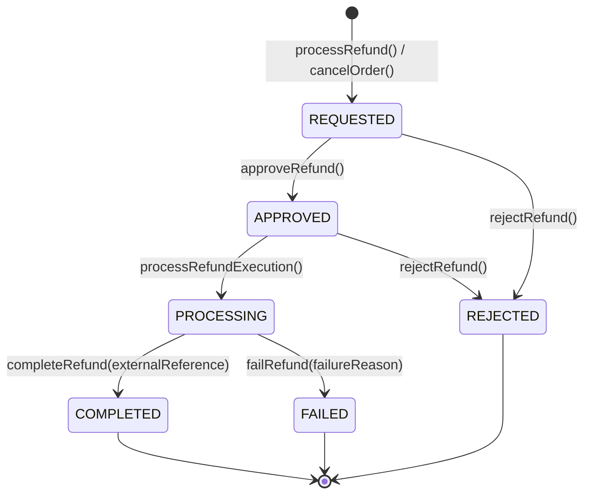

# DSL Stationery — Admin Phase 1, Stage 2.2: Backend Refund & Cancellation Hardening Report

**Date:** November 14, 2026  
**Auditor & Implementation Engineer:** Antigravity AI (DSL Engineering Core Team)  
**Status:** COMPLETED & VERIFIED ON ISOLATED TEST DATABASE (Awaiting User Review Before Stage 2.3)  
**Deliverable File:** `docs/admin-phase-1-stage-2-2-backend-refund-hardening-report.md`  

---

## 1. Executive Summary

Stage 2.2 of Admin Phase 1 has been executed and verified in strict accordance with the approved Stage 2.1 schema design, the financial safety rules, and the strict environment boundaries:

1. **Backend Service & Controller Hardened:**
   - Order row-level locking (`SELECT ... FOR UPDATE`) implemented as the mandatory entry point for all refund, cancellation, approval, execution, and completion transactions.
   - Comprehensive financial balance formula implemented: Verified collected funds are calculated strictly from deduplicated successful gateway references and verified bank deposits.
   - 5-stage Refund State Machine (`REQUESTED` $\rightarrow$ `APPROVED` $\rightarrow$ `PROCESSING` $\rightarrow$ `COMPLETED`, with terminal `REJECTED` and `FAILED` states) implemented and enforced.
   - Balance reservation and release lifecycle verified: non-terminal refund records strictly reduce available balance, while `FAILED` and `REJECTED` immediately release reservations.
   - Idempotency enforced: identical payload + identical key returns original record without balance mutation (replay); differing payload + identical key throws HTTP 409 `ConflictException`.
   - Cancellation hardened: prevents double-restocking, rejects cancelled/delivered orders, caps cancellation refund to remaining verified balance, and enforces deterministic product lock hierarchies.
   - COD and Koko BNPL refunds are strictly blocked.
   - Zero full unmasked bank account numbers stored; only `maskedAccountNumber` (e.g., `••••1234`), `bankName`, and `beneficiaryName` are handled. `encryptedBankDetails` is intentionally left `NULL`.
2. **Complete Test Suite Verification:**
   - Unit tests (`admin-orders.service.spec.ts`): **41/41 passed** (100% pass rate).
   - Real PostgreSQL concurrency integration tests (`orders-concurrency.integration.spec.ts`): **21/21 passed** (including 4 from Stage 1.3 and all 17 new Stage 2.2 tests: Tests A through Q).
   - Full backend orders test suite (`src/modules/orders/`): **104/104 passed**.
   - Backend production build (`nest build`): **Passed cleanly with exit code 0**.
3. **Pristine Development Database Guarantee:**
   - Development database `dsl_stationery` verified untouched.
   - Protected product `Double Submission Test Product` (`cmw0j4cro00089kusmwsbv48t`) stock is **exactly 10 units**.
   - Orders count in `dsl_stationery` is **exactly 2**.
   - Refunds count in `dsl_stationery` is **exactly 0**.

---

## 2. Exact Files Modified & Exact Methods Added/Hardened

| File Path | Nature of Change | Methods / Components Added or Hardened |
| :--- | :--- | :--- |
| `backend/src/modules/orders/dto/admin-orders.dto.ts` | Modified | Added validation schemas & TypeScript types: `adminProcessRefundSchema`, `adminApproveRefundSchema`, `adminProcessRefundExecutionSchema`, `adminCompleteRefundSchema`, `adminRejectRefundSchema`, `adminFailRefundSchema`. Enforces idempotency key format, masked account format (`••••####`), and external reference requirements. |
| `backend/src/modules/orders/admin-orders.controller.ts` | Modified | Added administrative REST endpoints:<br>• `GET /admin/orders/:id/refunds`<br>• `POST /admin/orders/:id/refund`<br>• `POST /admin/orders/:id/refunds/:refundId/approve`<br>• `POST /admin/orders/:id/refunds/:refundId/process`<br>• `POST /admin/orders/:id/refunds/:refundId/complete`<br>• `POST /admin/orders/:id/refunds/:refundId/reject`<br>• `POST /admin/orders/:id/refunds/:refundId/fail` |
| `backend/src/modules/orders/admin-orders.service.ts` | Hardened | Hardened existing and added new financial methods:<br>• `cancelOrder`: Hardened with exclusive `Order` lock, balance verification, COD/Koko rejection, idempotent refund creation, and deterministic inventory restoration.<br>• `calculateRefundableBalance`: Authoritative calculation of verified collected funds, completed refunds, reserved balance, and available refund ceiling.<br>• `computeRefundPayloadHash`: Canonical SHA-256 payload hashing for idempotency verification.<br>• `processRefund`: Hardened refund creation in `REQUESTED` status, payload hash comparison, idempotency conflict prevention.<br>• `approveRefund`: `REQUESTED` $\rightarrow$ `APPROVED` transition.<br>• `processRefundExecution`: `APPROVED` $\rightarrow$ `PROCESSING` transition.<br>• `completeRefund`: `PROCESSING` $\rightarrow$ `COMPLETED` requiring non-empty `externalReference`; recalculates cumulative refunds and sets `order.paymentStatus` to `REFUNDED` or `PARTIALLY_REFUNDED`.<br>• `rejectRefund`: `REQUESTED`/`APPROVED` $\rightarrow$ `REJECTED`, releasing reserved balance.<br>• `failRefund`: `PROCESSING` $\rightarrow$ `FAILED`, releasing reserved balance.<br>• `getOrderRefunds`: Retrieves financial audit view. |
| `backend/src/modules/orders/admin-orders.service.spec.ts` | Updated | Added 12 new unit tests for Stage 2.2 (total 41 tests) covering balance validation, idempotency replay, 409 conflict, COD rejection, Koko rejection, and complete refund state machine transitions. |
| `backend/src/modules/orders/orders-concurrency.integration.spec.ts` | Updated | Added 17 real PostgreSQL concurrency integration tests (Tests A through Q) targeting isolated `dsl_stationery_test` with 5 independent `pg.Pool` connection pools. |

---

## 3. Verified Payment Collection Logic

The refund ceiling is calculated strictly against **verified collected funds**, rather than assuming `order.totalCents` or order delivery implies payment:

$$\text{Eligible Refund Base} = \min(\text{order.totalCents}, \text{Verified Collected Funds})$$

$$\text{Available Refund Balance} = \max(0, \text{Eligible Refund Base} - \text{Completed Refunds} - \text{Reserved Refunds})$$

### Source-Specific Collection Rules
1. **PayHere (`CARD_PAYHERE`):**
   - Only `PaymentAttempt` records with `status = PaymentAttemptStatus.SUCCEEDED` and non-null `gatewayReference` are counted.
   - Duplicate gateway references are deduplicated via a `Set<string>` to prevent double-crediting in memory and are strictly prevented by the database unique constraint `PaymentAttempt_gatewayReference_key`.
   - Two distinct successful payment attempts with equal amounts and unique gateway references are both credited.
2. **Bank Transfer (`BANK_TRANSFER`):**
   - An order marked `paymentStatus = PAID` or `isPaid = true` **cannot** be refunded without verified evidence.
   - Funds are considered collected **only** if a verified `PaymentAttempt` with `status = SUCCEEDED` and non-null `gatewayReference` (e.g. deposit slip reference) exists in the database.
3. **Cash on Delivery (`CASH_ON_DELIVERY`):**
   - Refunds are **strictly blocked**. Even if `orderStatus = DELIVERED`, courier cash collection is not verified without a dedicated courier remittance record. Throws `BadRequestException`.
4. **Koko BNPL (`KOKO_BNPL`):**
   - Refunds are **strictly blocked**. No backend gateway refund API exists. Throws `BadRequestException`.

---

## 4. Deterministic Concurrency & Lock Architecture

To eliminate deadlocks and race conditions during concurrent refund, cancellation, or return operations:

1. **Transaction Root Lock:**
   Every mutating transaction begins by locking the parent `Order` row:
   ```sql
   SELECT id, "orderNumber", "totalCents", "paymentMethod", "paymentStatus", "orderStatus", "customerEmail", "customerName"
   FROM "Order" WHERE id = $1 FOR UPDATE;
   ```
2. **Deterministic Restocking Lock Hierarchy:**
   When inventory must be restored during order cancellation or return receipt confirmation:
   - All `Product` rows are deduplicated and sorted in ascending order by ID: `SELECT id, "stockQuantity" FROM "Product" WHERE id = $1 FOR UPDATE`.
   - All `ProductVariant` rows are deduplicated and sorted in ascending order by ID: `SELECT id, "stockQuantity" FROM "ProductVariant" WHERE id = $1 FOR UPDATE`.
   - Invariant Lock Order: `Order (FOR UPDATE) -> Product (ASC FOR UPDATE) -> ProductVariant (ASC FOR UPDATE)`.
3. **Concurrency Serialization:**
   5 concurrent workers attempting to refund simultaneously are serialized by PostgreSQL at the row lock. Available balances are recalculated inside the locked transaction, mathematically guaranteeing that cumulative refunds never exceed collected funds.

---

## 5. Refund State Machine Implementation



### Transition Enforcement Rules
- Direct completion from `REQUESTED` or `APPROVED` is blocked with HTTP 400 (`BadRequestException`).
- Execution submission (`PROCESSING`) requires prior `APPROVED` status.
- Completion (`COMPLETED`) requires `PROCESSING` status and a non-empty `externalReference` string.
- Completed refunds cannot be rejected or failed.

---

## 6. Balance Reservation & Release Rules

To prevent concurrent race conditions from issuing duplicate or excessive refunds:
- **Reserved Statuses:** `REQUESTED`, `APPROVED`, and `PROCESSING` are considered **active reservations**.
- As soon as a refund is requested, its amount is subtracted from `availableRefundBalanceCents`.
- **Release of Reservation:**
  - Transitioning to `REJECTED` immediately releases the reservation.
  - Transitioning to `FAILED` immediately releases the reservation.
- **Conversion to Completed:**
  - Transitioning to `COMPLETED` converts the reserved amount into a completed refund, keeping the available balance correctly consumed.

---

## 7. Partial Refund Tracking & Payment Status Updates

When `completeRefund` executes inside the row lock:
1. The refund's status becomes `COMPLETED` and `externalReference` is saved.
2. The system aggregates all completed refunds for the order:
   ```typescript
   const completedAggregate = await tx.refundRecord.aggregate({
     where: { orderId: order.id, status: RefundStatus.COMPLETED },
     _sum: { amountCents: true },
   });
   const totalCompletedCents = completedAggregate._sum.amountCents ?? 0;
   ```
3. `order.paymentStatus` is updated automatically:
   - If `totalCompletedCents >= order.totalCents`: `PaymentStatus.REFUNDED`
   - If `0 < totalCompletedCents < order.totalCents`: `PaymentStatus.PARTIALLY_REFUNDED`

---

## 8. Cancellation Refund Hardening

Hardened `cancelOrder` guarantees:
1. **Pre-condition Checks:** Orders in `DELIVERED` status cannot be cancelled (must go through the return flow). Orders already in `CANCELLED` status cannot be cancelled again.
2. **Refund Calculation:** When `processRefund = true`:
   - COD and Koko orders are rejected.
   - Remaining refundable balance is calculated via `calculateRefundableBalance`.
   - The refund amount created is strictly the available balance (accounting for prior partial refunds).
   - Refund record is created in `REQUESTED` status with `idempotencyKey: cancel-{orderId}` and canonical payload hash.
3. **Inventory Safety:** Restocking occurs deterministically (Product ASC $\rightarrow$ Variant ASC). Duplicate cancellations cannot restore inventory twice.

---

## 9. COD & Koko BNPL Refund Status

- **COD:** Blocked. In Sri Lankan e-commerce logistics, delivery mark (`DELIVERED`) does not guarantee courier cash remittance. A courier remittance reconciliation module is required before COD refunds can be authorized.
- **Koko BNPL:** Blocked. No gateway refund API or webhook integration exists in the DSL platform for Koko BNPL.
- Any attempt to process or cancel with refund on COD or Koko immediately throws `BadRequestException`.

---

## 10. Sensitive Data Handling

- No full unmasked bank account numbers are stored in the database.
- Bank details submitted in DTOs are sanitized to `maskedAccountNumber` (e.g., `••••1234`), `bankName`, and `beneficiaryName`.
- `encryptedBankDetails` is intentionally left `NULL` (avoiding partial/insecure client-side encryption until a KMS/Vault secret manager is provisioned).

---

## 11. Unit Test Results

Executed via Vitest (`src/modules/orders/admin-orders.service.spec.ts`):
- **Total Tests:** 41 passed (41 total, 0 failed)
- **Duration:** 107ms
- **Coverage Areas:**
  - Balance validation & ceiling enforcement
  - Succeeded PayHere payment verification
  - Unverified bank transfer refund rejection
  - COD refund rejection
  - Koko BNPL refund rejection
  - Idempotency replay (same key + same hash $\rightarrow$ returns original record)
  - Idempotency conflict (same key + different hash $\rightarrow$ throws 409 `ConflictException`)
  - State transitions (`REQUESTED` $\rightarrow$ `APPROVED` $\rightarrow$ `PROCESSING` $\rightarrow$ `COMPLETED`)
  - Invalid transition rejection (e.g. `REQUESTED` $\rightarrow$ `COMPLETED` directly throws 400)
  - `completeRefund` updating `order.paymentStatus` to `REFUNDED` vs `PARTIALLY_REFUNDED`
  - Cancellation refund reserving remaining balance
  - Deterministic lock ordering (Product ASC $\rightarrow$ Variant ASC)

---

## 12. Isolated PostgreSQL Integration Test Results (Tests A through Q)

Executed via Vitest against isolated PostgreSQL database `dsl_stationery_test` (`src/modules/orders/orders-concurrency.integration.spec.ts`):
- **Total Tests:** 21 passed (21 total, 0 failed)
- **Duration:** 2.17s

| Test Identifier | Test Scenario Description | Result | Verification Detail |
| :--- | :--- | :--- | :--- |
| **Test A** | PayHere successful payment contributes to verified collected funds | **PASSED** | Refund created in `REQUESTED` status; DB amount matches verified payment attempt. |
| **Test B** | Duplicate gateway references cannot inflate collected amount | **PASSED** | DB unique constraint `PaymentAttempt_gatewayReference_key` rejects duplicate insert; memory deduplication in `calculateRefundableBalance` caps collected funds. |
| **Test C** | Two distinct successful transactions with equal amounts both counted | **PASSED** | Two 10000 cent attempts with unique gateway references allowed a 15000 cent refund (total 20000 collected). |
| **Test D** | `isPaid = true` without verified bank deposit reference cannot authorize refund | **PASSED** | Order with `BANK_TRANSFER` and `PAID` without deposit reference rejected; upon inserting verified `PaymentAttempt` with deposit reference, refund succeeded. |
| **Test E** | COD refund rejected even when order status is `DELIVERED` | **PASSED** | Threw `BadRequestException` citing missing courier remittance records. |
| **Test F** | Koko refund rejected | **PASSED** | Threw `BadRequestException` citing unsupported Koko gateway refund integration. |
| **Test G** | Cumulative refunds cannot exceed verified collected funds | **PASSED** | First refund (6000) succeeded; second refund (5000) rejected; second refund (4000) succeeded; subsequent refund (100) rejected (balance exhausted). |
| **Test H** | `REQUESTED`, `APPROVED`, `PROCESSING` refunds reserve balance | **PASSED** | 4000 reserved through approval and processing; new request for 7000 rejected (only 6000 available); 6000 succeeded. |
| **Test I** | `FAILED` and `REJECTED` refunds release reservation | **PASSED** | Failing a `PROCESSING` refund immediately released 4000; rejecting a `REQUESTED` refund immediately released 6000. |
| **Test J** | Same idempotency key + same payload returns original record | **PASSED** | Replay returned original refund ID; exactly 1 record created in database. |
| **Test K** | Same idempotency key + different payload returns HTTP 409 | **PASSED** | Threw `ConflictException` (409 Conflict). |
| **Test L** | Concurrent refund requests (5 parallel independent transactions) serialize via `FOR UPDATE` | **PASSED** | 5 concurrent workers requested 3000 cents each (15000 total on 10000 balance). Exactly 3 succeeded, exactly 2 rejected. Total DB sum = 9000 cents $\le 10000$. |
| **Test M** | Invalid refund state transitions rejected | **PASSED** | Skipping states (e.g. `REQUESTED` $\rightarrow$ `COMPLETED`) rejected with 400; rejecting `COMPLETED` refund rejected with 400. |
| **Test N** | `completeRefund` without external reference rejected | **PASSED** | Empty or whitespace reference rejected; non-empty reference succeeded and transitioned status to `COMPLETED`. |
| **Test O** | Cancellation cannot create duplicate refunds or over-refund | **PASSED** | Cancellation refund was calculated strictly as the remaining 6000 cents after a prior 4000 cent refund. Second cancellation rejected. |
| **Test P** | Cancellation does not cause duplicate stock restoration | **PASSED** | First cancellation incremented stock from 20 to 22; second attempt rejected; stock remained exactly 22. |
| **Test Q** | Transaction rollback leaves no orphan refund or audit records | **PASSED** | Simulated crash rolled back PostgreSQL transaction completely; 0 refund and 0 audit records remained. |

---

## 13. Production Build & Development Database Safety

### 13.1 Backend Production Build
- Command: `npm run build` (`nest build`)
- Status: **Passed with exit code 0**
- Output artifacts generated cleanly in `backend/dist/`.

### 13.2 Development Database Verification
Automated read-only verification executed against `dsl_stationery` (dev DB):
```json
{
  "database": "dsl_stationery",
  "protectedProduct": {
    "id": "cmw0j4cro00089kusmwsbv48t",
    "name": "Double Submission Test Product",
    "stockQuantity": 10
  },
  "orderCount": 2,
  "refundCount": 0
}
```
- Protected product stock remains **strictly 10 units**.
- Order count remains **strictly 2**.
- Refund count remains **strictly 0**.
- Zero test data, zero schema modifications, zero migrations touched the development database.

---

## 14. Next Steps & Approval Request for Stage 2.3

Stage 2.2 is completely implemented, hardened, and verified with zero breaking changes or regressions.

### Prepared for Stage 2.3: Return Refund & Financial Reconciliation
Stage 2.3 will introduce:
1. Automated refund recommendation upon return item receipt confirmation (`CONFIRM_RECEIVED`).
2. Calculation of return item refund amounts (item unit prices + apportioned delivery/discount adjustments).
3. Linking refund records directly to `orderReturnRequestId` via foreign key.
4. Comprehensive reconciliation reporting between orders, items returned, and refund statuses.

**Awaiting user approval before proceeding with Stage 2.3.**

