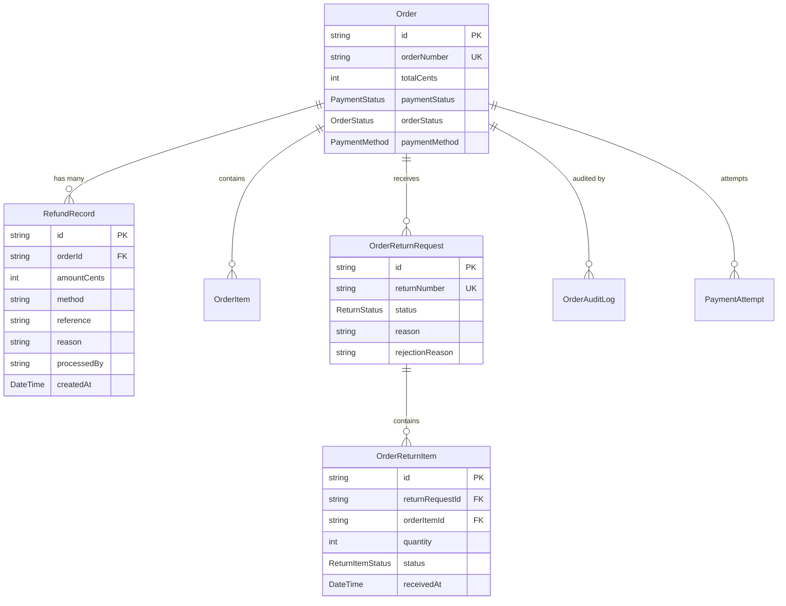
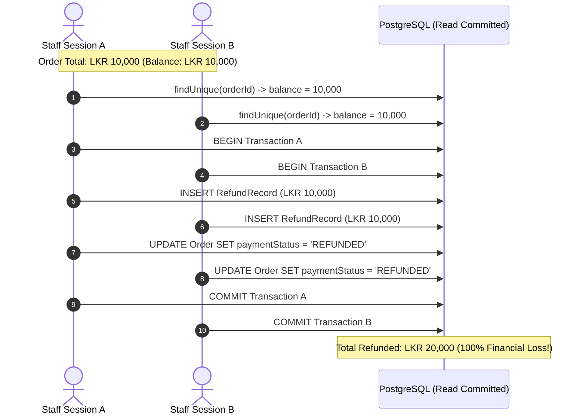
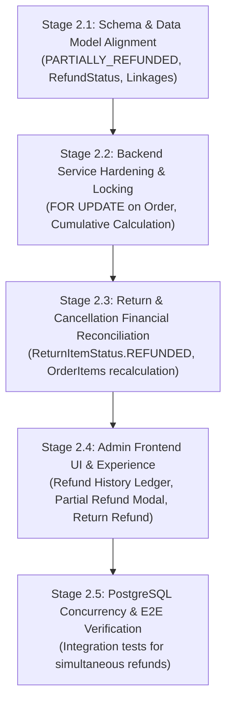

# DSL Stationery — Admin Phase 1, Stage 2: Refund Safety Audit

**Date:** November 14, 2026  
**Auditor:** Antigravity AI (DSL Engineering Core Team)  
**Status:** COMPLETE (AUDIT-ONLY — Zero Code/Schema Mutations)  
**Audit Target:** Order Refund, Cancellation, Return-Restock Financial Workflows & Payment Gateway Consistency  
**Target File:** `docs/admin-phase-1-stage-2-refund-safety-audit.md`

---

## 1. Executive Summary & Audit Scope

As part of the DSL Stationery Admin Panel Upgrade (Phase 1: Make Order Operations Dependable), Stage 1, Stage 1.1, Stage 1.2, and Stage 1.3 successfully hardened order return requests, deterministic multi-row locking, inventory restock integrity, and PostgreSQL integration concurrency tests.

**Stage 2** conducts an exhaustive technical audit of the **Refund and Cancellation Architecture**. This audit investigates:
1. Financial correctness, cumulative refund calculations, and balance validations.
2. Race conditions, concurrent double-refund execution, and transaction row locking.
3. Order and payment state machine integrity (`PaymentStatus`, `OrderStatus`, `ReturnStatus`).
4. Operational gaps between manual ledger entries and live payment gateways (PayHere Card, Koko BNPL, Bank Transfer, COD).
5. Disconnections between the frontend UI, client services, and backend endpoints.
6. Role-Based Access Control (RBAC), multi-party approval requirements, and audit trail fidelity.

### Strict Safety & Baseline Compliance
- **Zero Modifications:** No application code, configuration files, or database schemas have been altered.
- **No Gateway Calls:** No PayHere or Koko payment or refund APIs were invoked.
- **Database Integrity:** The development database (`dsl_stationery`) remains untouched.
  - Protected Product: `Double Submission Test Product` (`cmw0j4cro00089kusmwsbv48t`) stock was verified at **exactly 10 units**.
  - `onlineCardEnabled` remains `false`.
  - No database commits, resets, truncations, or seeds occurred.

---

## 2. Existing Architecture & Workflow Inventory

### 2.1 File & Component Inventory

| Component / Layer | File Path | Primary Responsibilities & Line References |
| :--- | :--- | :--- |
| **Prisma Schema** | `backend/prisma/schema.prisma` | Lines 384–405 (`Order`), 493–508 (`OrderAuditLog`), 523–554 (`OrderReturnRequest`, `OrderReturnItem`), 556–568 (`RefundRecord`), 574–580 (`PaymentAttempt`) |
| **Admin Controller** | `backend/src/modules/orders/admin-orders.controller.ts` | Lines 49–50 (Class Guards/Roles), 131–142 (`POST :id/cancel`), 178–189 (`POST :id/refund`), 191–196 (`GET :id/audit-history`) |
| **Admin Service** | `backend/src/modules/orders/admin-orders.service.ts` | Lines 286–360 (`updateStatus`), 599–860 (`updateOrderItems`), 899–1035 (`cancelOrder`), 1464–1546 (`processRefund`) |
| **DTOs & Schemas** | `backend/src/modules/orders/dto/admin-orders.dto.ts` | Lines 64–70 (`adminCancelOrderSchema`), 103–110 (`adminProcessRefundSchema`) |
| **Checkout & Payments**| `backend/src/modules/checkout/checkout.controller.ts`<br>`backend/src/modules/checkout/checkout.service.ts` | PayHere webhook processing (Line 194), IPN signature validation, payment attempt tracking |
| **Frontend Service** | `frontend/src/services/orderService.ts` | Lines 505–533 (`cancelOrderApi`), 538–551 (`processRefundApi`) |
| **Frontend UI** | `frontend/src/components/admin/orders/CancelOrderModal.tsx`<br>`frontend/src/app/admin/orders/[id]/page.tsx`<br>`frontend/src/components/admin/orders/ReturnManagementCard.tsx` | Cancellation modal with auto-checked refund; Order detail payment panel; Return management component |
| **Frontend Types** | `frontend/src/types/order.ts` | Lines 20–30 (`PaymentStatus`), 32–44 (`PaymentMethod`), 123–148 (`Order` interface) |
| **Unit & Integration Tests**| `backend/src/modules/orders/admin-orders.service.spec.ts`<br>`backend/src/modules/orders/orders-concurrency.integration.spec.ts` | Unit tests for `cancelOrder` (lines 220–257) and `processRefund` (lines 266–308); Concurrency suite |

---

### 2.2 Data Model Review



---

## 3. Detailed Technical Findings & Vulnerability Analysis

```
+--------------------------------------------------------------------------------------------------+
|                                    RISK SEVERITY SUMMARY                                         |
+-------------------+------------------------------------------------------------------------------+
| CRITICAL (3)      | 1. Cumulative Refund Validation Failure (Infinite Over-Refunding)           |
|                   | 2. Unpaid / Failed / Cancelled Order Refund Acceptance                       |
|                   | 3. Lack of Database Row-Level Locking in Refund & Cancel Workflows           |
+-------------------+------------------------------------------------------------------------------+
| HIGH (4)          | 4. Destructive Partial Refund State Mutation (Premature REFUNDED Overwrite)  |
|                   | 5. Cancellation vs. Prior Refunds Desynchronization & Silent Shortchanging   |
|                   | 6. Operational "Ghost Refund" Illusion (Zero Payment Gateway Reversals)     |
|                   | 7. Order Item Modification Mutating Totals without Financial Reconciliation  |
+-------------------+------------------------------------------------------------------------------+
| MEDIUM (4)        | 8. Non-Enforced Idempotency Keys on Refund Records                           |
|                   | 9. Dead State & Missing Foreign Key Linkage (Return-to-Refund)               |
|                   | 10. Frontend Dead Code & Total Absence of Return Refund UI                   |
|                   | 11. Coarse-Grained RBAC & Missing Multi-Party Approval Workflow             |
+-------------------+------------------------------------------------------------------------------+
| LOW (1)           | 12. Audit Trail Incompleteness & Real-Time Event Payload Gaps                |
+-------------------+------------------------------------------------------------------------------+
```

---

### 3.1 CRITICAL RISKS

#### Finding 1: Cumulative Refund Validation Failure (Infinite Over-Refunding)
- **File:** `backend/src/modules/orders/admin-orders.service.ts`
- **Location:** Lines 1474–1478
- **Code:**
  ```typescript
  if (dto.amountCents > order.totalCents) {
    throw new BadRequestException(
      `Refund amount (Rs. ${(dto.amountCents / 100).toFixed(2)}) cannot exceed order grand total (Rs. ${(order.totalCents / 100).toFixed(2)})`
    );
  }
  ```
- **Vulnerability Mechanism:**  
  The validation only evaluates whether the *current single request* (`dto.amountCents`) exceeds `order.totalCents`. It **never** queries existing `RefundRecord` rows for the order and does not compute `previouslyRefundedCents`.
- **Exploitation Scenario:**
  1. Customer places an order for LKR 10,000 (`totalCents = 1,000,000`).
  2. Staff issues Refund 1 for LKR 8,000 (`800,000 <= 1,000,000` $\rightarrow$ passes).
  3. Staff or another administrator issues Refund 2 for LKR 8,000 (`800,000 <= 1,000,000` $\rightarrow$ passes).
  4. Total refunded in `RefundRecord` is now LKR 16,000 on an LKR 10,000 order.
  5. Any arbitrary number of refunds can be executed indefinitely, draining corporate accounts.

---

#### Finding 2: Unpaid / Failed / Cancelled Order Refund Acceptance
- **File:** `backend/src/modules/orders/admin-orders.service.ts`
- **Location:** Lines 1464–1478
- **Vulnerability Mechanism:**  
  `processRefund` does not inspect `order.paymentStatus`. It permits recording refunds against orders whose payment status is:
  - `PaymentStatus.PENDING` (e.g., unpaid Cash on Delivery orders, unverified bank transfers, pending card sessions)
  - `PaymentStatus.FAILED` (e.g., declined credit cards)
  - `OrderStatus.CANCELLED` (without prior payment)
- **Financial Impact:**  
  Staff can record cash disbursements or initiate manual bank refunds to customers who never paid a single cent.

---

#### Finding 3: Lack of Database Row-Level Locking in Refund & Cancel Workflows
- **File:** `backend/src/modules/orders/admin-orders.service.ts`
- **Location:** Lines 920–939 (`cancelOrder`), lines 1469–1481 (`processRefund`)
- **Vulnerability Mechanism:**
  1. In `processRefund`, `order` is retrieved via `findUnique` outside the transaction. Inside `this.prisma.$transaction`, no row-level locking (`SELECT ... FOR UPDATE`) is acquired on the `Order` table.
  2. In `cancelOrder`, locks are acquired on `Product` and `ProductVariant`, but **never** on `Order`.
- **Race Condition Scenario:**
  - If an administrator double-clicks the "Process Refund" button or two staff members trigger refunds concurrently:
    - Both transactions run concurrently under PostgreSQL `READ COMMITTED` isolation.
    - Both read `previouslyRefundedCents` as 0.
    - Both insert `RefundRecord` rows and commit.
  - If `cancelOrder` runs concurrently with `processRefund`:
    - `cancelOrder` creates a full cancellation refund while `processRefund` simultaneously records a partial/full refund.

---

### 3.2 HIGH RISKS

#### Finding 4: Destructive Partial Refund State Mutation (`PaymentStatus.REFUNDED` Overwrite)
- **File:** `backend/src/modules/orders/admin-orders.service.ts` (lines 1492–1497) & `backend/prisma/schema.prisma` (lines 582–587)
- **Code:**
  ```typescript
  await tx.order.update({
    where: { id: order.id },
    data: {
      paymentStatus: PaymentStatus.REFUNDED,
    },
  });
  ```
- **Vulnerability Mechanism:**  
  The Prisma schema enum `PaymentStatus` only contains: `PENDING`, `PAID`, `FAILED`, `REFUNDED`. There is no `PARTIALLY_REFUNDED` enum value.  
  As a result, recording even a partial refund of LKR 100 on an LKR 50,000 order permanently sets the order's payment status to `REFUNDED`.
- **Operational Impact:**
  - Downstream finance, reports, and delivery staff see `paymentStatus = REFUNDED` and assume the customer has been completely settled.
  - The order can no longer be distinguished from fully refunded orders in filters and dashboards.

---

#### Finding 5: Cancellation vs. Prior Refunds Desynchronization & Silent Shortchanging
- **File:** `backend/src/modules/orders/admin-orders.service.ts`
- **Location:** Lines 990–1003
- **Code:**
  ```typescript
  let newPaymentStatus = order.paymentStatus;
  if (dto.processRefund && (order.paymentStatus === PaymentStatus.PAID)) {
    await tx.refundRecord.create({
      data: {
        orderId: order.id,
        amountCents: order.totalCents,
        method: 'CANCELLATION_REFUND',
        reference: `REF-CANC-${order.orderNumber}`,
        reason: dto.reason,
        processedBy: actor?.name || 'Staff',
      },
    });
    newPaymentStatus = PaymentStatus.REFUNDED;
  }
  ```
- **Two Compounding Flaws:**
  1. **Case A (Prior Partial Refund Exists):** If an order was partially refunded via `processRefund`, its `paymentStatus` was set to `REFUNDED`. When the order is subsequently cancelled with `processRefund: true`, the condition `order.paymentStatus === PaymentStatus.PAID` evaluates to `false`!  
     $\rightarrow$ The remaining balance is **silently ignored**, and zero cancellation refund is recorded.
  2. **Case B (If order remained PAID):** `cancelOrder` creates a refund for `order.totalCents` in full, completely ignoring any prior refunds that occurred.

---

#### Finding 6: Operational "Ghost Refund" Illusion (Zero Gateway Integration)
- **File:** `frontend/src/app/admin/orders/[id]/page.tsx` (lines 546–552) & `frontend/src/components/admin/orders/CancelOrderModal.tsx` (lines 114–124)
- **Vulnerability Mechanism:**  
  The backend contains **zero payment gateway refund API clients** (neither PayHere nor Koko). When an order is cancelled or a refund is recorded in the admin panel:
  - An internal database row in `RefundRecord` is created.
  - The order payment status is set to `REFUNDED`.
  - The admin UI displays: `Refund Status: Refund Processed`.
- **Operational Hazard:**  
  Administrators and customer support agents assume the funds have been returned to the customer's credit card or Koko BNPL account. In reality, **zero gateway refund request was made**. Unless staff manually logs into the PayHere/Koko Merchant Portal to execute an external reversal, the customer is never reimbursed, leading to customer disputes, chargebacks, and legal liability.

---

#### Finding 7: Order Item Modification Mutating Totals without Financial Reconciliation
- **File:** `backend/src/modules/orders/admin-orders.service.ts`
- **Location:** Lines 818–847 (`updateOrderItems`)
- **Vulnerability Mechanism:**  
  When staff adds or removes items from an order:
  - If items are removed from a `PAID` order, `subtotalCents` and `totalCents` are reduced (e.g. from LKR 10,000 to LKR 6,000).
  - The customer originally paid LKR 10,000, creating an unrecorded credit of LKR 4,000.
  - No `RefundRecord` is created, no overpayment status is flagged, and future refunds are capped at the new lower `totalCents` (LKR 6,000).
  - Conversely, increasing item quantities increases `totalCents` to LKR 14,000 while leaving `paymentStatus: PAID`, masking an unpaid shortage of LKR 4,000.

---

### 3.3 MEDIUM & LOW RISKS

#### Finding 8: Non-Enforced Idempotency Keys on Refund Records
- **File:** `backend/prisma/schema.prisma` (lines 556–568)
- `RefundRecord.reference` is defined as `String?` without a unique constraint or composite index (`@@unique([orderId, reference])`).
- If an admin clicks submit multiple times or a network retry resends the request, identical duplicate records with identical references can be committed.

---

#### Finding 9: Dead State & Missing Foreign Key Linkage (Return-to-Refund)
- **File:** `backend/prisma/schema.prisma` (lines 485–491, 556–568)
- In the database schema, `enum ReturnItemStatus` defines `REFUNDED`. However, across the entire backend, `ReturnItemStatus.REFUNDED` is **never assigned** (it remains `RECEIVED`).
- Furthermore, `RefundRecord` contains no foreign key or relation to `OrderReturnRequest` or `OrderReturnItem`. There is no mechanism to track which return request a refund was issued for.

---

#### Finding 10: Frontend Dead Code & Total Absence of Return Refund UI
- **File:** `frontend/src/services/orderService.ts` (lines 538–551) & `frontend/src/components/admin/orders/ReturnManagementCard.tsx`
- `orderService.processRefundApi` is implemented in TypeScript, but **zero components in the entire frontend invoke it**.
- In `ReturnManagementCard.tsx`, actions exist for `APPROVE`, `REJECT`, and `CONFIRM_RECEIVED`. Once items are physically received and restocked, there is no button, modal, or form to issue or record a refund for those returned items.
- In `frontend/src/types/order.ts`, the `Order` interface does not include `refundRecords?: RefundRecord[]`, and the admin order detail page does not display a refund history table.

---

#### Finding 11: Coarse-Grained RBAC & Missing Multi-Party Approval Workflow
- **File:** `backend/src/modules/orders/admin-orders.controller.ts` (lines 49–50)
- Endpoints `@Post(':id/refund')` and `@Post(':id/cancel')` inherit class-level permissions `@Roles(UserRole.STAFF, UserRole.MANAGER, UserRole.ADMIN)`.
- Junior `STAFF` members can unilaterally issue refunds of any magnitude without manager or admin approval.

---

#### Finding 12: Audit Trail Incompleteness & Real-Time Event Gaps
- **File:** `backend/src/modules/orders/admin-orders.service.ts` (lines 1499–1510)
- The audit log action is recorded as `REFUND_RECORDED`, but does not record the breakdown of refundable balance, cumulative total refunded, or reference numbers in structured metadata columns.

---

## 4. Payment Method Specific Vulnerability Matrix

| Payment Method | Actual Collection Point | Current System Behavior | Operational & Financial Risk | Remediation Requirement |
| :--- | :--- | :--- | :--- | :--- |
| **CARD_PAYHERE** | Online Gateway via PayHere Hosted Checkout | Marks `RefundRecord` internally as `REFUNDED`; sets order to `REFUNDED`. | **CRITICAL:** Funds never returned to card. Admin assumes refund complete. Customer files chargeback. | 1. Clarify manual vs gateway reversal.<br>2. Add gateway reference tracking.<br>3. Require gateway settlement verification before marking refunded. |
| **KOKO_BNPL** | 3-Installment Gateway via Koko API | Creates ledger entry; no Koko reversal triggered. | **HIGH:** Customer continues to be debited monthly installments by Koko for cancelled/returned goods. | Explicit modal warning + Koko merchant refund reference requirement. |
| **BANK_TRANSFER** | Offline Manual Customer Deposit | `cancelOrder` creates refund with method `CANCELLATION_REFUND`. | **HIGH:** Accounts department receives no structured task or alert with customer bank details to transfer funds. | Capture bank details (Bank, Branch, Account, Beneficiary Name) and route to finance approval queue. |
| **CASH_ON_DELIVERY**| Physical Cash Collected by Courier on Delivery | If cancelled prior to dispatch, `isPaid` is false. If return is accepted post-delivery, no payment collection verification exists. | **CRITICAL:** If order is marked `DELIVERED` but courier hasn't remitted cash, refunding issues company money for uncollected funds. | Verify `paymentStatus === PAID` before permitting refund; enforce manual bank transfer details for COD returns. |

---

## 5. Concurrency & Transactional Integrity Analysis

### 5.1 Lock Hierarchy Comparison

In Stage 1.2, we established a strict, deterministic lock hierarchy to prevent PostgreSQL deadlocks:
$$\text{Order} \longrightarrow \text{Product (ASC)} \longrightarrow \text{ProductVariant (ASC)}$$

Comparing the existing implementation across all order mutation workflows:

| Workflow | Order Row Lock | Product Lock Order | Variant Lock Order | Concurrency Safety Status |
| :--- | :--- | :--- | :--- | :--- |
| **`processReturnStatus`** (Stage 1.2) | `SELECT ... FOR UPDATE` | $P_1 < P_2 < \dots < P_n$ | $V_1 < V_2 < \dots < V_m$ | **PROTECTED & VERIFIED** |
| **`cancelOrder`** | **MISSING** (No Order lock) | $P_1 < P_2 < \dots < P_n$ | $V_1 < V_2 < \dots < V_m$ | **VULNERABLE** to race conditions |
| **`processRefund`** | **MISSING** (No Order lock) | None | None | **CRITICAL VULNERABILITY** |
| **`updateOrderItems`** | **MISSING** (No Order lock) | Unordered sequential updates | Unordered sequential updates | **DEADLOCK HAZARD** |

### 5.2 The Double-Submission Race Condition in `processRefund`



**Root Cause:**
Neither transaction acquires `SELECT id FROM "Order" WHERE id = $1 FOR UPDATE`. Under standard `READ COMMITTED` isolation, both transactions execute without blocking and successfully commit double refunds.

---

## 6. Test Suite & Verification Gap Analysis

### 6.1 Existing Test Assessment
1. **Unit Tests (`admin-orders.service.spec.ts`):**
   - Lines 220–257: Only 1 mock test for `cancelOrder` checking that `refundRecord.create` is called when `processRefund: true`.
   - Lines 266–308: Only 2 mock tests for `processRefund`:
     - Test 1: `throws if refund exceeds totalCents` (tests a single call with 150,000 > 100,000).
     - Test 2: `creates refund record and updates order paymentStatus` (tests single call with 100,000 == 100,000).
   - **Gap:** These tests use Vitest mock objects (`vi.fn()`) and cannot verify database constraints, concurrency, race conditions, or cumulative refund sums.
2. **Integration Tests (`orders-concurrency.integration.spec.ts`):**
   - Contains 4 tests verifying `createReturnRequest` and `processReturnStatus` concurrency against real PostgreSQL.
   - **Gap:** **Zero** integration tests exist for `processRefund` or `cancelOrder` concurrency.

---

## 7. Staged Remediation Plan (Stage 2 Implementation Roadmap)

To maintain stability and adhere to the project's strict engineering discipline, remediation should be executed across five controlled sub-stages:



### Stage 2.1: Database Schema & Entity Enhancements
- **Objectives:**
  1. Add `PARTIALLY_REFUNDED` to `enum PaymentStatus`.
  2. Add `enum RefundStatus { PENDING_APPROVAL, PROCESSED, FAILED, REJECTED }` to support approval lifecycles.
  3. Update `RefundRecord` model:
     - Add `orderReturnRequestId String?` relation.
     - Add `status RefundStatus @default(PROCESSED)`.
     - Add `currency String @default("LKR")`.
     - Add `processedById String?`.
     - Enforce `@@unique([orderId, reference])` when reference is provided.

### Stage 2.2: Backend Service Hardening & Deterministic Row Locking
- **Objectives:**
  1. In `processRefund`:
     - Acquire row lock on `Order` first: `SELECT id, "totalCents", "paymentStatus" FROM "Order" WHERE id = $1 FOR UPDATE`.
     - Query sum of existing `RefundRecord` amounts where status is `PROCESSED`: `SUM(amountCents)`.
     - Validate: `dto.amountCents + previouslyRefundedCents <= order.totalCents`.
     - Validate: `order.paymentStatus` must be `PAID` or `PARTIALLY_REFUNDED`.
     - Transition `paymentStatus` to `REFUNDED` if `newRefundedTotal === order.totalCents`, otherwise `PARTIALLY_REFUNDED`.
  2. In `cancelOrder`:
     - Acquire row lock on `Order` first: `SELECT ... FOR UPDATE`.
     - If `dto.processRefund === true`: calculate remaining refundable balance: `max(0, order.totalCents - previouslyRefundedCents)`.
     - Only create refund for the *remaining unrefunded amount*.

### Stage 2.3: Return Financial Reconciliation & Item Adjustments
- **Objectives:**
  1. In return workflows: When a return is received and restocked, allow linking a refund to the specific `orderReturnRequestId`.
  2. Transition returned items to `ReturnItemStatus.REFUNDED` once refunded.
  3. In `updateOrderItems`: Detect if total cents decrease on a paid order, creating an explicit credit balance audit entry rather than silently altering totals.

### Stage 2.4: Admin Frontend UI & Experience
- **Objectives:**
  1. Add `RefundLedgerCard` to Order Detail page displaying all historical refunds, timestamps, staff actors, methods, and references.
  2. Implement `ProcessRefundModal` with:
     - Display of Order Total, Already Refunded, and Maximum Allowable Refund.
     - Refund Method selector (Bank Transfer, PayHere Manual Reversal, Cash, Store Credit).
     - Bank account details collection for Bank Transfer refunds.
     - Clear disclaimer that card/BNPL gateway refunds require external merchant portal action until full API integration.
  3. Add "Issue Refund" action in `ReturnManagementCard` for received returns.

### Stage 2.5: PostgreSQL Concurrency & Integration Verification Suite
- **Objectives:**
  1. Add integration tests in `orders-concurrency.integration.spec.ts` executing 5 simultaneous refund requests against the same order in the dedicated `dsl_stationery_test` database.
  2. Verify that cumulative refund sum never exceeds `totalCents`.
  3. Verify deterministic lock sequence prevents deadlocks between concurrent cancellations and refund operations.

---

## 8. Quality Gates & Acceptance Criteria for Stage 2

| ID | Quality Gate / Acceptance Criterion | Verification Method |
| :--- | :--- | :--- |
| **QG-1** | Cumulative refund cannot exceed `order.totalCents` across multiple partial refunds. | Unit test + Concurrency test rejecting over-refund attempts. |
| **QG-2** | Refunds cannot be processed on `PENDING`, `FAILED`, or unpaid orders. | API validation test returning `400 Bad Request`. |
| **QG-3** | Order with partial refund transitions to `PARTIALLY_REFUNDED`, not `REFUNDED`. | State transition test checking `Order.paymentStatus`. |
| **QG-4** | Concurrent refund requests against the same order serialize cleanly without race conditions. | `Promise.all` test on real PostgreSQL (`dsl_stationery_test`). |
| **QG-5** | Order cancellation on a partially refunded order only refunds the remaining unrefunded balance. | Calculation test verifying cancellation refund amount. |
| **QG-6** | Refund history is visible to administrators on the Order Detail page. | Frontend component rendering verification. |
| **QG-7** | Zero regressions on Stage 1 / Stage 1.2 / Stage 1.3 return and restock flows. | Full backend test suite execution (`75/75 passing`). |
| **QG-8** | Development database (`dsl_stationery`) and protected product stock remain untouched. | Direct database query verifying 10 stock units. |

---

## 9. Final Audit Verdict

```
+--------------------------------------------------------------------------------------------------+
|                                    AUDIT VERDICT: FAIL                                           |
|                               (CRITICAL VULNERABILITIES IDENTIFIED)                             |
+--------------------------------------------------------------------------------------------------+
| The existing refund workflow is NOT SAFE for production operations.                             |
|                                                                                                  |
| 1. Financial Over-Refunding: Administrators can issue unlimited refunds exceeding order totals. |
| 2. Phantom Card Refunds: Admins are shown "Refund Processed" when no gateway refund was made.    |
| 3. Concurrency Double-Submissions: Simultaneous requests bypass checks and double-debit funds.    |
| 4. Partial Refund State Corruption: Partial refunds permanently mark orders as fully REFUNDED.   |
| 5. Silent Shortchanging on Cancellation: Partially refunded orders get zero cancellation refund. |
|                                                                                                  |
| Recommendation: Await user approval, then proceed with Stage 2.1 implementation plan.            |
+--------------------------------------------------------------------------------------------------+
```

---

*Report compiled and certified by Antigravity AI — DSL Engineering Core Team.*

