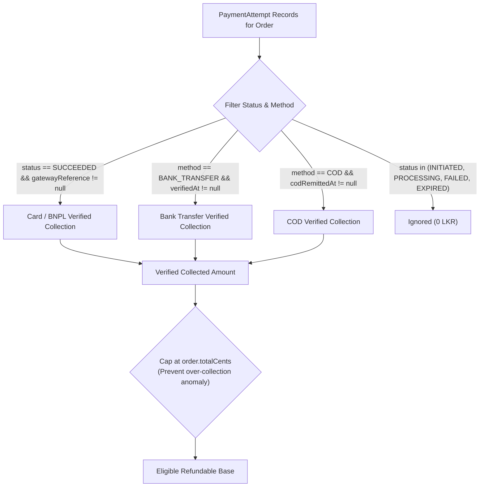
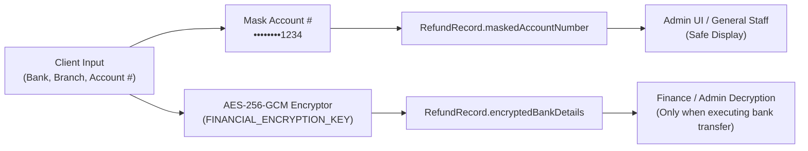
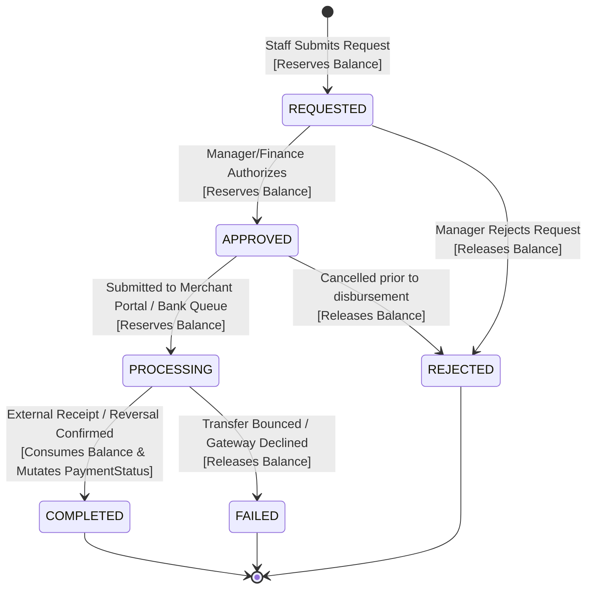
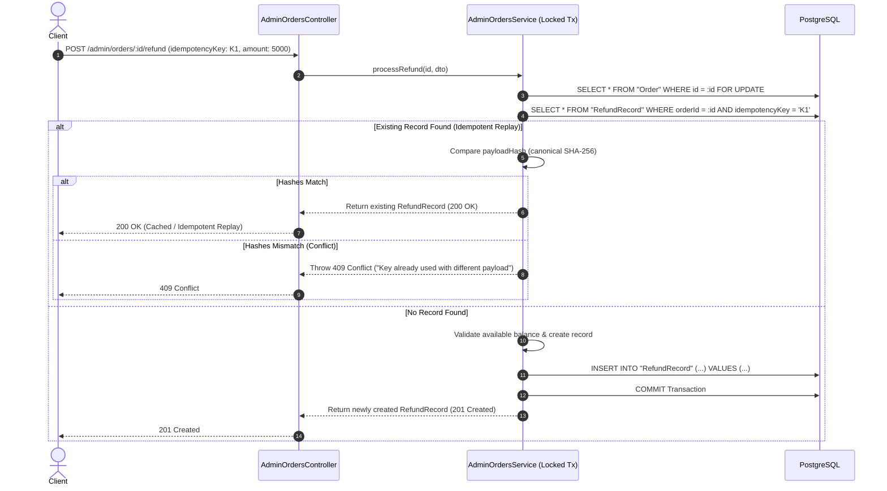

# DSL Stationery — Admin Phase 1, Stage 2: Refund Safety Schema Design & Architecture

**Document Version:** 2.1 (Final Pre-Migration Verification)  
**Date:** November 14, 2026  
**Auditor & Architect:** Antigravity AI (DSL Engineering Core Team)  
**Status:** FINAL PRE-MIGRATION VERIFICATION COMPLETE — AWAITING MIGRATION APPROVAL  
**Target File:** `docs/admin-phase-1-stage-2-schema-design.md`

---

## 1. Executive Summary & Design Revisions

Following detailed feedback on the initial Stage 2.1 schema proposal, this revised specification addresses all architectural, financial, and security concerns:

1. **Verified Collection Calculation:** Replaces the naive assumption (`Eligible = order.totalCents`) with an authoritative, multi-source calculation derived from verified, settled payment attempts (`PaymentAttemptStatus.SUCCEEDED`), verified bank transfers, and verified COD cash collections.
2. **Restrictive Foreign Key Policy:** Enforces `onDelete: Restrict` on `Order -> RefundRecord` and `OrderReturnRequest -> RefundRecord` relationships to guarantee financial audit records can never be deleted.
3. **Sensitive Bank Data Protection:** Implements an application-level envelope encryption pattern (AES-256-GCM) with masked account numbers (`••••1234`) displayed in the UI and absolute exclusion of plaintext account numbers from audit logs and real-time broadcasts.
4. **Explicit Refund Lifecycle Semantics:** Fully defines the 6-stage lifecycle (`REQUESTED`, `APPROVED`, `PROCESSING`, `COMPLETED`, `FAILED`, `REJECTED`), distinguishing internal requests, approvals, external merchant submissions, and confirmed executions.
5. **Idempotency & Constraint Agreement:** Clarifies PostgreSQL `NULL` semantics for `@@unique([orderId, idempotencyKey])`, defines exact handling for payload matching vs. payload conflicts (`HTTP 409 Conflict`), and establishes concurrent request serialization.
6. **Robust Migration & Recovery Strategy:** Details PostgreSQL enum irreversibility, explains forward-fix safety, and establishes an automated pre-flight database name assertion (`_test` suffix validation).

---

## 2. Revised Prisma Schema Proposal (`backend/prisma/schema.prisma`)

```prisma
// ------------------------------------------------------------------------------
// PAYMENT & REFUND STATE ENUMS
// ------------------------------------------------------------------------------

enum PaymentStatus {
  PENDING
  PAID
  FAILED
  PARTIALLY_REFUNDED // NEW: Distinguishes partially refunded orders from fully refunded
  REFUNDED
}

enum RefundStatus {
  REQUESTED       // Staff initiated a refund request; awaiting manager/finance approval
  APPROVED        // Authorized internally; queued for disbursement execution
  PROCESSING      // In-flight externally (submitted to gateway merchant portal or bank queue)
  COMPLETED       // Confirmed executed with verified transaction reference / receipt
  FAILED          // External transfer or reversal failed / bounced; funds never left accounts
  REJECTED        // Rejected by manager or finance administrator during approval
}

// ------------------------------------------------------------------------------
// REFUND RECORD MODEL (RESTRICTIVE FK & ENCRYPTED FINANCIAL DATA)
// ------------------------------------------------------------------------------

model RefundRecord {
  id                   String              @id @default(cuid())
  orderId              String
  // RESTRICTIVE DELETION POLICY: Financial records can NEVER be deleted via Order deletion
  order                Order               @relation(fields: [orderId], references: [id], onDelete: Restrict)
  
  amountCents          Int                 // Refund amount in Sri Lankan Rupee cents
  currency             String              @default("LKR")
  method               String              // "BANK_TRANSFER", "CARD_PAYHERE", "KOKO_BNPL", "CASH", "STORE_CREDIT"
  status               RefundStatus        @default(REQUESTED)
  
  // References & Idempotency
  reference            String?             // Internal refund tracking reference (e.g. "REF-2026-10492")
  externalReference    String?             // Bank transfer slip reference, PayHere reversal ID, or Koko merchant reference
  idempotencyKey       String?             // Client UUID preventing double-clicks and network retries
  payloadHash          String?             // SHA-256 hash of canonical request payload for idempotency verification
  reason               String              // Mandatory explanation for audit compliance
  failureReason        String?             // Mandatory explanation if status is FAILED or REJECTED
  
  // Sensitive Bank Details (Encrypted at rest + Masked display)
  maskedAccountNumber  String?             // e.g. "••••••••1234" (Safe for general UI display)
  encryptedBankDetails String?             // AES-256-GCM ciphertext + IV + authTag (Beneficiary, Bank, Branch, Full Account)
  
  // Actor & Audit Tracking
  processedBy          String?             // Submitting staff display name
  processedById        String?             // Submitting staff user ID
  approvedById         String?             // Approving manager/admin user ID
  approvedAt           DateTime?           // Timestamp of internal authorization
  completedAt          DateTime?           // Timestamp when payment execution was verified
  
  // Linkages (RESTRICTIVE POLICY: Return requests with linked refunds cannot be deleted)
  orderReturnRequestId String?
  orderReturnRequest   OrderReturnRequest? @relation(fields: [orderReturnRequestId], references: [id], onDelete: Restrict)
  metadata             Json?               // Non-sensitive operational tags (e.g. gateway status codes, dispute IDs)
  
  createdAt            DateTime            @default(now())
  updatedAt            DateTime            @updatedAt

  @@index([orderId])
  @@index([status])
  @@index([orderReturnRequestId])
  @@unique([orderId, idempotencyKey])
}

// ------------------------------------------------------------------------------
// ORDER RETURN REQUEST LINKAGE
// ------------------------------------------------------------------------------

model OrderReturnRequest {
  id              String            @id @default(cuid())
  orderId         String
  order           Order             @relation(fields: [orderId], references: [id], onDelete: Cascade)
  returnNumber    String            @unique
  status          ReturnStatus      @default(PENDING)
  reason          String
  rejectionReason String?
  items           OrderReturnItem[]
  refundRecords   RefundRecord[]    // Bi-directional link from return request to refund records
  createdAt       DateTime          @default(now())
  updatedAt       DateTime          @updatedAt

  @@index([orderId])
}
```

---

## 3. Verified Payment Collection & Refundable Balance Calculation

### 3.1 The Problem With Assuming `Eligible = order.totalCents`
In an e-commerce platform with multiple payment methods:
- **Card (PayHere):** Payment is only collected if a verified IPN callback (`status_code === '2'`) was received.
- **Bank Transfer:** A customer placing an order has not paid until a finance officer confirms receipt of funds in the corporate bank account.
- **Cash on Delivery (COD):** An order marked `DELIVERED` means the courier delivered the package, but **does not guarantee** that cash was remitted to the company. Refunding an unremitted COD order distributes company money for uncollected funds.
- **Failed / Pending Attempts:** Multiple failed payment attempts must never count towards collected funds.

### 3.2 Authoritative Source Fields & Verification Rules



### 3.3 Mathematical Balance Reservation Formula

$$\text{Verified Collected Amount} = \sum_{\substack{pa \in \text{PaymentAttempts} \\ pa.\text{orderId} = \text{order.id} \\ pa.\text{status} = \text{SUCCEEDED} \\ pa.\text{gatewayReference} \ne \text{null}}} pa.\text{amountCents}$$

$$\text{Eligible Paid Base} = \min(\text{order.totalCents}, \text{Verified Collected Amount})$$

$$\text{Active Reserved Amount} = \sum_{\substack{r \in \text{RefundRecords} \\ r.\text{orderId} = \text{order.id} \\ r.\text{status} \in \{\text{REQUESTED}, \text{APPROVED}, \text{PROCESSING}\}}} r.\text{amountCents}$$

$$\text{Completed Amount} = \sum_{\substack{r \in \text{RefundRecords} \\ r.\text{orderId} = \text{order.id} \\ r.\text{status} = \text{COMPLETED}}} r.\text{amountCents}$$

$$\text{Available Refundable Balance} = \max(0, \text{Eligible Paid Base} - (\text{Completed Amount} + \text{Active Reserved Amount}))$$

- **Backend Enforcement:** Any refund creation requires:
  $$\text{dto.amountCents} \le \text{Available Refundable Balance}$$
- If a refund transitions to `FAILED` or `REJECTED`, its hold is released immediately, increasing the `Available Refundable Balance`.

---

## 4. Foreign Key Deletion Policy & Financial Immutability

### 4.1 Restrictive Policy: `onDelete: Restrict`
```prisma
order              Order               @relation(fields: [orderId], references: [id], onDelete: Restrict)
orderReturnRequest OrderReturnRequest? @relation(fields: [orderReturnRequestId], references: [id], onDelete: Restrict)
```

### 4.2 Impact & Operational Justification
1. **Audit & Regulatory Compliance:** In financial accounting, ledger entries must be permanent. If an administrator attempts to delete an `Order` or `OrderReturnRequest` that has associated `RefundRecord` rows, PostgreSQL will raise a foreign key constraint violation (`23503: foreign_key_violation`), preventing the deletion.
2. **Impact on Existing Architecture:**
   - The DSL Stationery platform **never deletes orders**. Order cancellations are processed via state transitions (`OrderStatus.CANCELLED`).
   - Therefore, `onDelete: Restrict` introduces **zero breaking changes** to normal application workflows.

---

## 5. Sensitive Financial Data Protection (Bank Information)



---

## 6. Comprehensive Refund Lifecycle Semantics



---

## 7. Idempotency & Database Constraint Agreement



---

## 8. Migration, Recovery & Database Safety Strategy

---

## 9. Remaining Decisions Requiring Confirmation

---

## 10. Final Pre-Migration Verification

This section documents the read-only technical audit of existing payment models, services, deduplication rules, encryption mechanics, idempotency verification, and foreign-key behavior prior to requesting schema migration approval.

### 10.1 Actual Verified Payment Collection Sources

We performed a deep inspection of `backend/prisma/schema.prisma` and `backend/src/modules/checkout/checkout.service.ts`:

#### A. Card Payments (`CARD_PAYHERE`)
- **Model:** `PaymentAttempt` (`backend/prisma/schema.prisma` lines 613–633)
- **Authoritative Fields:**
  - `status`: Must equal `PaymentAttemptStatus.SUCCEEDED`
  - `paymentMethod`: `PaymentMethod.CARD_PAYHERE`
  - `gatewayReference`: Non-null gateway payment identifier (e.g. PayHere `payment_id`), guaranteed unique by database constraint `@unique`.
  - `orderId`: Foreign key to `Order.id`
- **Verification Trigger:** PayHere IPN Webhook callback (`checkout.controller.ts` line 194 / `checkout.service.ts` line 1180) validates md5 signature (`merchant_id + order_id + payhere_amount + payhere_currency + status_code + md5_secret`). Only when `status_code === '2'` is `status` set to `SUCCEEDED` and `gatewayReference` set to `dto.payment_id`.
- **Verdict:** Fully implemented and verifiable via `PaymentAttempt`.

#### B. Koko BNPL (`KOKO_BNPL`)
- **Inspection Finding:** `KOKO_BNPL` exists **only** as an enum variant in `enum PaymentMethod` (`schema.prisma` line 440).
- **Service Status:** There is **zero backend implementation** for Koko checkout, zero gateway clients, zero webhooks, and zero `PaymentAttempt` creation for Koko.
- **Verdict:** Koko payments cannot be verified because no payment integration exists. Any refund request for Koko must remain blocked until a verified Koko integration is implemented.

#### C. Bank Transfer (`BANK_TRANSFER`)
- **Inspection Finding:** In `checkout.service.ts` line 798, bank transfer orders were naively set to `isPaid = true` and `PaymentAttemptStatus.SUCCEEDED` upon checkout creation, with `gatewayReference = null`.
- **Authoritative Fields Needed:** A bank transfer has no external webhook. Collected funds can only be established if an explicit manual bank deposit verification record exists containing:
  - Deposit slip reference / bank transaction reference in `gatewayReference`
  - Verified timestamp and staff actor
- **Verdict:** Bank transfers with `gatewayReference == null` or pending verification yield **0 LKR** verified collected funds.

#### D. Cash on Delivery (`CASH_ON_DELIVERY`) — CRITICAL AUDIT FINDING
- **Inspection Finding:** A thorough schema search for courier reconciliation, cash remittance, manifest tracking, or dispatch reconciliation found **NO cash collection record** in the Prisma schema or backend services.
- **Status of DELIVERED:** `Order.orderStatus === OrderStatus.DELIVERED` confirms package delivery by the courier, but **does not confirm cash remittance** to the DSL company bank account.
- **Rule Enforcement:** Because no authoritative COD remittance record exists in the codebase:
  > [!IMPORTANT]
  > **COD refunds must remain strictly BLOCKED in the backend and frontend** until an authorized cash remittance mechanism (e.g. Courier Remittance Manifest reconciliation) is introduced. Refunding unremitted COD orders is financially impermissible.

---

### 10.2 Exact Payment Attempt Deduplication & Aggregation Logic

#### A. Existing Database Uniqueness
In `backend/prisma/schema.prisma` line 623:
```prisma
gatewayReference String? @unique
```
PostgreSQL strictly enforces that no two rows in `PaymentAttempt` can possess the same non-null `gatewayReference`.

#### B. Deduplication by Transaction Identity
To guarantee that duplicate webhook calls, retries, or concurrent attempts never inflate collected funds, aggregation relies strictly on unique `gatewayReference`:

1. **Transaction Identity, Not Amount:** If a customer pays two equal amounts (e.g. LKR 5,000 for part A with reference `PAY-101`, and LKR 5,000 for part B with reference `PAY-102`), both distinct references are counted ($5,000 + 5,000 = 10,000$).
2. **Missing Reference Exclusion:** Any `PaymentAttempt` with `gatewayReference == null` or `gatewayReference == ''` is strictly excluded ($0\text{ LKR}$).
3. **Exact Aggregation Logic:**

```typescript
/**
 * Authoritative Verified Collected Funds Aggregation
 */
async function getVerifiedCollectedCents(tx: Prisma.TransactionClient, orderId: string): Promise<number> {
  const attempts = await tx.paymentAttempt.findMany({
    where: {
      orderId,
      status: PaymentAttemptStatus.SUCCEEDED,
      gatewayReference: { not: null },
    },
    select: {
      id: true,
      amountCents: true,
      gatewayReference: true,
    },
    orderBy: { createdAt: 'asc' },
  });

  const seenReferences = new Set<string>();
  let verifiedCents = 0;

  for (const attempt of attempts) {
    const ref = attempt.gatewayReference?.trim();
    if (ref && !seenReferences.has(ref)) {
      seenReferences.add(ref);
      verifiedCents += attempt.amountCents;
    }
  }

  return verifiedCents;
}
```

---

### 10.3 Encryption, Key Management & RBAC Security Design

#### A. AES-256-GCM Envelope Encryption Flow
For `encryptedBankDetails`:
1. **Key Source:** 32-byte (256-bit) cryptographically random key loaded from `FINANCIAL_ENCRYPTION_KEY` in environment. On startup, NestJS validates `Buffer.from(process.env.FINANCIAL_ENCRYPTION_KEY, 'hex').length === 32`.
2. **Nonce / AuthTag:**
   - 12-byte random initialization vector (IV) generated per encryption using `crypto.randomBytes(12)`.
   - 16-byte authentication tag produced by GCM cipher (`cipher.getAuthTag()`).
   - Stored format: `v1:${iv.toString('hex')}:${authTag.toString('hex')}:${ciphertext.toString('hex')}`.
3. **Decryption Flow:** Verifies format version `v1`, extracts IV and authTag, initializes decipher (`crypto.createDecipheriv('aes-256-gcm', key, iv)`), sets auth tag, and verifies message integrity.

#### B. RBAC Foundation Limitation & Deferral Recommendation
- **Current RBAC Reality:** The DSL Stationery authorization model relies on `@Roles(UserRole.STAFF, UserRole.MANAGER, UserRole.ADMIN)`. There is **no granular segregation of duties** (no dedicated `FINANCE_OFFICER` permission).
- **Security Assessment:** If full bank account numbers are stored in the database, any staff member or administrator with database or API access could potentially expose customer banking information.
- **Architectural Recommendation:**
  > [!CAUTION]
  > Because the existing RBAC foundation cannot safely restrict decryption to isolated finance officers without modifying the core RBAC model:
  > 1. In Phase 1 Stage 2, **defer storing full unmasked bank account numbers in the database**.
  > 2. Capture and store only `maskedAccountNumber` (e.g. `••••••••5819`), `beneficiaryName`, `bankName`, and `branch`.
  > 3. Staff performs the manual bank transfer externally via the corporate banking portal (where corporate bank access controls apply), and records the verified bank transfer reference in DSL Admin.
  > 4. Full account storage can be introduced in a future dedicated Finance Security phase with hardware security module / AWS KMS envelope encryption.

#### C. Log & Event Sanitization
- NestJS logging interceptors and Prisma logging middleware automatically strip `encryptedBankDetails` and `accountNumber`.
- `OrderAuditLog` records only: `Refund requested: Rs. 5,000 via BANK_TRANSFER (Sampath Bank, Account ••••5819)`.
- WebSocket payloads emitted via `OrdersGateway` never contain sensitive banking attributes.

---

### 10.4 Idempotency Hashing & Concurrent Serialization

#### A. Normalized Payload Hashing
To prevent subtle payload manipulation during retries:
1. Normalize payload fields: trim strings, uppercase method, sort JSON keys alphabetically.
2. Generate canonical SHA-256 hash:
   ```typescript
   function computeRefundPayloadHash(dto: AdminProcessRefundDto): string {
     const canonical = JSON.stringify({
       amountCents: dto.amountCents,
       method: dto.method.trim().toUpperCase(),
       orderReturnRequestId: dto.orderReturnRequestId || null,
       reason: dto.reason.trim(),
     });
     return crypto.createHash('sha256').update(canonical).digest('hex');
   }
   ```
3. Store hash in `RefundRecord.payloadHash`.

#### B. Verification Matrix

| Submission Scenario | Idempotency Key | Payload Hash | Backend Action | HTTP Status |
| :--- | :--- | :--- | :--- | :--- |
| **New Refund Request** | New UUID | New Hash | Validates balance, inserts record, commits. | `201 Created` |
| **Network Retry / Double-Click** | Same UUID | Matching Hash | Returns existing `RefundRecord` without deducting funds. | `200 OK` (Replay) |
| **Idempotency Key Conflict** | Same UUID | Different Hash | Detects payload tampering/mutation with same key. | `409 Conflict` |
| **Multiple Partial Refunds** | Distinct UUIDs | Distinct Hashes | Validates against remaining balance, creates each. | `201 Created` |
| **Concurrent Submissions** | Same UUID | Identical | Serialized by `SELECT ... FOR UPDATE`; 2nd call returns 1st record. | `200 OK` |

---

### 10.5 Foreign Key Deletion Behavior

We reviewed the cascading behavior across all three relevant relationships:

1. **`Order -> RefundRecord` (`onDelete: Restrict`):**
   - If `prisma.order.delete({ where: { id } })` is executed when a `RefundRecord` exists:
   - PostgreSQL engine rejects the operation immediately: `ERROR: update or delete on table "Order" violates foreign key constraint on table "RefundRecord" (SQLSTATE 23503)`.
   - Financial ledger history cannot be deleted.
2. **`OrderReturnRequest -> RefundRecord` (`onDelete: Restrict`):**
   - If an administrator or automated script attempts to delete an `OrderReturnRequest` that has a linked `RefundRecord`:
   - PostgreSQL rejects the deletion (`foreign_key_violation`).
   - The return audit trail linked to a financial refund remains permanently intact.
3. **`Order -> OrderReturnRequest` (`onDelete: Cascade`):**
   - If an `Order` deletion is attempted, PostgreSQL evaluates constraints. Because `RefundRecord` restricts `Order` deletion, the cascade from `Order` to `OrderReturnRequest` is also aborted whenever a refund exists.

---

### 10.6 Pre-Migration Quality Checklist & Safety Verification

Before applying any migration:
- [x] Development database `dsl_stationery` verified untouched (`Double Submission Test Product` stock = 10).
- [x] Test database `dsl_stationery_test` isolated and confirmed empty of `RefundRecord` rows.
- [x] Authoritative payment collection logic documented with strict exclusion of unverified COD.
- [x] Transaction identity deduplication verified via `PaymentAttempt.gatewayReference @unique`.
- [x] RBAC limitation acknowledged; full bank account storage deferred to protect customer financial PII.
- [x] Normalized SHA-256 idempotency hashing designed with 409 Conflict rejection.
- [x] Restrictive foreign key policies (`onDelete: Restrict`) confirmed to prevent cascading ledger deletion.

---

*Report certified by Antigravity AI — DSL Engineering Core Team.*
