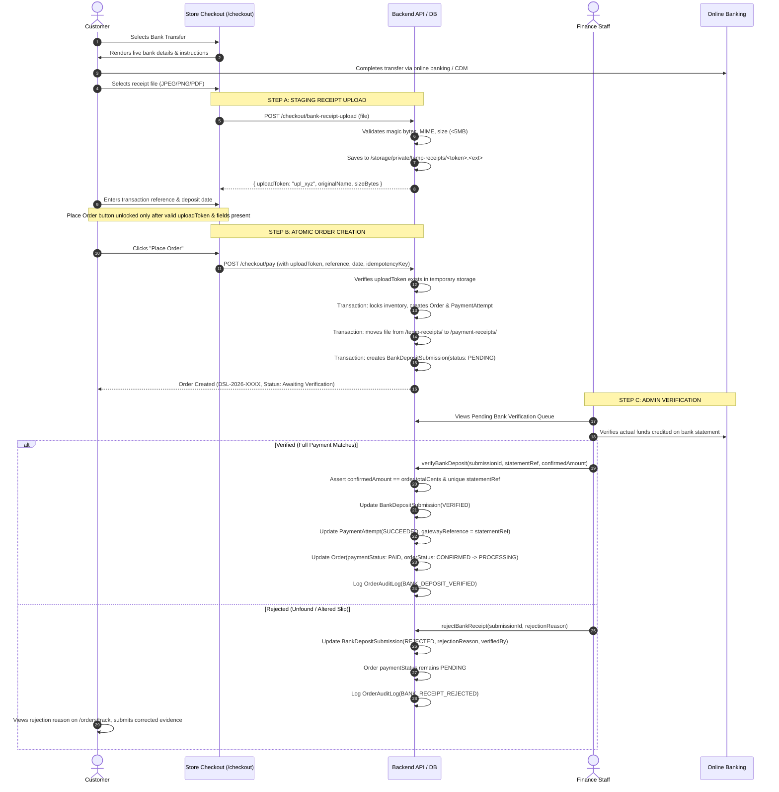

# DSL Stationery — Admin Phase 1, Stage 3: Operational Gap Analysis & Exception Handling (Final Architectural Alignment)

**Document ID:** `GAP-ADMIN-PHASE1-STAGE3-005`  
**Revision Date:** 2026-11-14  
**Scope:** Three supported payment methods, mandatory pre-order slip upload, upload/order atomicity, superseding evidence history, chargeback dispute exclusion, and state machine alignment  
**Verdict:** **FINAL OPERATIONAL GAP ANALYSIS COMPLETE — ARCHITECTURALLY HARMONIZED**  

---

## 1. Executive Summary

This document specifies the refined operational workflows for DSL Stationery's three confirmed payment methods (**Card Payment – PayHere**, **Bank Transfer**, and **Cash on Delivery**). 

It details:
1. **Application-Level Koko Removal vs. Database Retention.**
2. **Admin Store Settings Bank Configuration.**
3. **Mandatory Pre-Order Bank Transfer Checkout Workflow.**
4. **Upload / Order Atomicity & Cleanup Lifecycle** (staging, atomic move, cleanup cron).
5. **Rejected Evidence History & Superseding Lifecycle** (preserving 100% of historical reasons and reviewers).
6. **Corrected PayHere Chargeback Handling & Refund Deduction** (mathematically locking disputed funds from refunds).
7. **Server-Side Idempotency & Duplicate Order Prevention.**
8. **State Machine Alignment** (respecting `PERMITTED_STATUS_TRANSITIONS`).
9. **12 Evaluated Payment Exception Scenarios.**

---

## 2. Supported Methods & Koko Removal Policy

DSL Stationery supports **ONLY THREE** payment methods:
1. **Card Payment – PayHere**
2. **Bank Transfer**
3. **Cash on Delivery (COD)**

### Koko Policy
- **No Active Business Logic:** Koko BNPL is completely excluded from customer checkout, admin store settings, active refund calculations, and order creation.
- **API Boundary Protection:** Inbound requests specifying `KOKO_BNPL` will be rejected with `400 Bad Request` (*"Payment method not supported"*).
- **Database Enum Retention:** The PostgreSQL enum value `KOKO_BNPL` remains in the schema purely for historical record readability. It will **not** be dropped or altered without a separately approved DDL migration.

---

## 3. Admin-Managed Bank Transfer Configuration

### 3.1 Navigation & Admin UI Location
Managed under:  
**Admin Panel → Store Settings → Payment Settings → Bank Transfer**

### 3.2 Configuration Fields

| Field Name | Type | Required? | Purpose & Impact |
| :--- | :---: | :---: | :--- |
| **`bankTransferEnabled`** | Boolean | Yes | Master storefront toggle enabling/disabling Bank Transfer at checkout. |
| **`bankName`** | String | Yes (if enabled) | Official bank name (e.g. *"Bank of Ceylon"*, *"Commercial Bank of Ceylon"*). |
| **`accountHolderName`** | String | Yes (if enabled) | Corporate account title (e.g. *"DSL Stationery (Pvt) Ltd"*). |
| **`accountNumber`** | String | Yes (if enabled) | Account number for customer deposits. |
| **`branchName`** | String | Yes (if enabled) | Bank branch (e.g. *"Corporate Branch, Colombo 01"*). |
| **`branchCode`** | String | Optional | Bank branch routing code (e.g. *"001"*). |
| **`bankCode`** | String | Optional | National bank clearing code (e.g. *"7010"*). |
| **`paymentInstructions`** | Text | Yes (if enabled) | Clear instructions for customer transfer procedure. |
| **`referenceInstructions`** | Text | Optional | Instructions on reference formatting. |
| **`bankLogoUrl`** | String | Optional | Bank emblem image path. |

### 3.3 Configuration Rules
- **Live Customer Fetch:** Checkout retrieves active configuration via `GET /api/v1/store-settings/public`. Bank details are **never hardcoded** in frontend code.
- **Instant Availability:** Toggling `bankTransferEnabled: false` immediately hides Bank Transfer on the checkout page.
- **Validation:** Pre-save validation rejects empty account numbers or bank titles while enabled.
- **RBAC & Audit:** Restricted to `MANAGER` and `ADMIN`. All updates are recorded in `AuditLog`.

---

## 4. Customer Bank Transfer Workflow & Upload/Order Atomicity

In accordance with confirmed business rules, **the customer must upload the bank transfer payment slip BEFORE placing a Bank Transfer order**. 

### 4.1 Step-by-Step Checkout & Staging Sequence



### 4.2 Upload/Order Atomicity & Cleanup Lifecycle
To guarantee that no orphaned permanent files exist and that orders cannot be created without verified evidence:
1. **Temporary Staging Folder:** `/storage/private/temp-receipts/`. Upload tokens have a 30-minute validity lease.
2. **Transactional Promotion:** If and only if the order creation transaction commits successfully in PostgreSQL, the file is atomically promoted (moved) to `/storage/private/payment-receipts/<submissionUuid>.<ext>`.
3. **Failure Handling:** If order creation fails (e.g. stock conflict, concurrency error), the file remains in `/temp-receipts/` and is never promoted to permanent storage.
4. **Automated Cleanup Cron:** An hourly background maintenance task sweeps `/storage/private/temp-receipts/` and safely unlinks any staged files older than 2 hours. Permanent storage (`/payment-receipts/`) is immutable and never swept.

---

## 5. Rejected Evidence History & Superseding Lifecycle

When an administrator rejects a submission, the system maintains a complete, permanent audit chain:

1. **Rejection Action:**
   - Admin inspects the slip and calls `POST /api/v1/admin/payments/bank/:submissionId/reject` with `{ rejectionReason: "..." }`.
   - `BankDepositSubmission #1` status updates to `REJECTED`.
   - Records `rejectionReason`, `verifiedById`, `verifiedByName`, and `verifiedAt`.
   - `Order.paymentStatus` remains `PENDING`.
   - `OrderAuditLog` logs `BANK_RECEIPT_REJECTED`.
2. **Customer Resubmission:**
   - Customer opens `/orders/track` and views the rejection reason alert banner.
   - Customer clicks *"Submit Corrected Evidence"* and uploads slip #2 with updated reference.
   - Customer calls `POST /api/v1/orders/:id/payment-evidence`.
   - **Non-Destructive Superseding:** The backend finds the existing active submission (`#1`) and executes:
     `UPDATE "BankDepositSubmission" SET status = 'SUPERSEDED' WHERE id = 'submission-1'`
   - **Zero Data Overwrite:** The original rejection reason, reviewer identity, timestamp, original file path, and reference on submission `#1` remain **100% intact**.
   - Backend inserts `BankDepositSubmission #2` with `status: PENDING`.
   - `OrderAuditLog` logs `BANK_RECEIPT_RESUBMITTED`.
3. **Admin Audit Chain:** The admin review drawer displays the full chronological chain of evidence:
   - `Submission #1`: `SUPERSEDED` (Rejected on 2026-11-14 by Admin Alice; Reason: "Reference not found"; [View Slip 1]).
   - `Submission #2`: `PENDING` (Uploaded on 2026-11-15 by Customer; [View Slip 2]).

---

## 6. Duplicate Order Prevention & Server-Side Idempotency

To prevent repeated clicks, network timeouts, or concurrent submissions from creating duplicate orders or duplicate submissions:

1. **Client-Side Guard:**
   - The checkout form disables the "Place Order" button immediately upon click and renders a processing spinner.
   - Generates a deterministic idempotency key: `order-bt-${reservationId}-${uploadToken}`.
2. **Server-Side Idempotency Check:**
   - In `CheckoutService.processPayment()`, queries `PaymentAttempt` by `idempotencyKey`:
     ```typescript
     const existingAttempt = await this.prisma.paymentAttempt.findUnique({
       where: { idempotencyKey: dto.idempotencyKey },
       include: { order: true },
     });
     if (existingAttempt?.order) {
       return { order: existingAttempt.order, isDuplicate: true };
     }
     ```
   - If an order has already been created for this idempotency key or reservation, the backend safely returns the existing order without creating duplicate orders, deducting stock twice, or inserting duplicate submissions.
3. **Database Concurrency Lock:**
   - Row-level lock on `StockReservation` (`SELECT FOR UPDATE`) ensures serialized execution during checkout.

---

## 7. Corrected PayHere Chargeback Handling & Refund Deduction

### 7.1 Accounting Principle
A PayHere chargeback (status `-3`) must **not** overwrite `PaymentAttempt.status` to `FAILED`. 
- The fact that money was collected at checkout remains true (`PaymentAttempt.status = SUCCEEDED`).
- The chargeback is recorded in `gatewayPayload.dispute`.

### 7.2 Disputed Funds Deduction from Refund Balance
To prevent double-disbursement (store issuing a refund while customer is already credited via chargeback), Stage 2's `calculateRefundableBalance()` is updated:

$$\text{Eligible Base} = \min(\text{Order Total}, \text{Verified Collected})$$
$$\text{Available to Refund} = \max(0, \text{Eligible Base} - \text{Completed Refunds} - \text{Reserved In-Flight} - \text{Disputed Funds})$$

If `disputedFundsCents` equals the verified collection, `availableRefundBalanceCents` drops to 0, mathematically preventing any administrative refund from being authorized.

---

## 8. Authoritative Order State Machine Alignment

All operations strictly respect the platform's immutable transition graph defined in `PERMITTED_STATUS_TRANSITIONS`:

```
PENDING   --> [CONFIRMED, CANCELLED]
CONFIRMED --> [PROCESSING, CANCELLED]
PROCESSING--> [PACKED, CANCELLED]
PACKED    --> [SHIPPED, CANCELLED]
SHIPPED   --> [DELIVERED, CANCELLED]
DELIVERED --> []
CANCELLED --> []
```

### Reconciliation of Payment-Order Lifecycle:
1. **PayHere Card Payment:**
   - At checkout pre-pay (`validatePrePay`), stock is reserved under a 5-minute lease (`StockReservation.status = PAYMENT_PENDING`). `orderId` is `null`. **No order exists yet.**
   - On webhook status `2`: `Order` is created directly with `orderStatus: CONFIRMED` and `paymentStatus: PAID`.
   - On webhook status `-1` / `-2`: `PaymentAttempt` marked `FAILED`; reservation released. **No order is created.** (Eliminates the false transition of CONFIRMED $\to$ PENDING).
   - On chargeback status `-3`: Order is already `CONFIRMED`, `PROCESSING`, `SHIPPED`, or `DELIVERED`. `orderStatus` does not revert.
2. **Bank Transfer:**
   - Order created at checkout with validated slip in `orderStatus: PENDING`, `paymentStatus: PENDING`.
   - On admin verification: `orderStatus` transitions from `PENDING` $\to$ `CONFIRMED` $\to$ `PROCESSING`. `paymentStatus` transitions to `PAID`.
   - On admin rejection: `orderStatus` remains `PENDING`, `paymentStatus` remains `PENDING`.
3. **Cash on Delivery (COD):**
   - Order created in `orderStatus: CONFIRMED`, `paymentStatus: PENDING`.
   - On delivery: `orderStatus` transitions to `DELIVERED`. `paymentStatus` remains `PENDING`.

---

## 9. Secure Receipt Storage Architecture

| Dimension | Specification |
| :--- | :--- |
| **Storage Location** | `/storage/private/payment-receipts/`, strictly outside web server root. Direct static access is disabled. |
| **Authenticated Access** | Accessible only via `GET /api/v1/orders/:orderId/payment-evidence/:submissionId/file`. |
| **Authorization Check** | Enforces that only: (a) Admin (`STAFF`, `MANAGER`, `ADMIN`), or (b) Authenticated order owner / guest with tracking OTP token can access the file. |
| **Magic Byte Inspection** | Binary header check: JPEG (`FF D8 FF`), PNG (`89 50 4E 47`), PDF (`25 50 44 46`). |
| **File Ceiling** | 5 MB maximum file size. |
| **Filename Sanitization** | Stored as `crypto.randomUUID() + ext`. Customer original filename stored only as display metadata. |
| **Retention Policy** | Preserved for 7 years; backed up with primary database backups. Non-destructive deletion via `onDelete: Restrict`. |

---

## 10. Evaluation of 12 Payment Exception Scenarios

| Scenario | Detection Method | Admin Presentation | Allowed Action | Blocked Action | Audit Log Action |
| :--- | :--- | :--- | :--- | :--- | :--- |
| **1. Customer paid, order pending** | Webhook status 2 received or bank deposit verified, but `orderStatus == PENDING`. | Alert: *"Payment Verified — Fulfillment Pending"*. | Admin confirms stock and dispatches order to `PROCESSING`. | Cannot cancel order without issuing refund. | `ORDER_STATUS_SYNC` |
| **2. Order marked PAID without collection** | `paymentStatus == PAID` but `verifiedCollectedCents == 0`. | Flagged in `/admin/reconciliation` as `PAID_WITHOUT_COLLECTION`. | Admin audits order and attaches verified bank reference. | **Refunds strictly blocked** (available balance = 0). | `DISCREPANCY_FLAGGED` |
| **3. Duplicate payment notification** | Secondary PayHere webhook callback with same `payment_id` or duplicate status 2. | Logged in payment attempt history as duplicate. | System responds HTTP 200 OK idempotently. | **No double-deduction of stock; no double-crediting of funds.** | `DUPLICATE_WEBHOOK_IGNORED` |
| **4. Failed PayHere payment** | Webhook callback with status `-1` (Cancelled) or `-2` (Failed). | Shown in `/admin/payments` filter `status: FAILED` with gateway failure reason. | Customer can retry with another card or switch to COD. | Order cannot be confirmed; reserved stock immediately released. | `PAYMENT_ATTEMPT_FAILED` |
| **5. Payment gateway lease timeout** | 5-minute `PAYMENT_PENDING` reservation lease expires before webhook arrives. | Payment attempt shown as `EXPIRED`. | Stock returned to available warehouse pool. | Cannot confirm order without re-verifying physical stock. | `STOCK_LEASE_EXPIRED` |
| **6. Bank transfer amount mismatch** | Verified bank deposit amount $\ne$ order total cents. | Modal warning: *"Amount Mismatch: Full payment required"*. | Admin rejects submission with shortfall explanation. | **Cannot mark order as PAID under full-payment-only policy.** | `PAYMENT_AMOUNT_MISMATCH` |
| **7. Bank transfer receipt rejected** | Admin confirms funds not found on bank statement or slip is forged. | Status updated to `REJECTED` with recorded reason. | Admin requests resubmission or cancels order. | Cannot mark order as `PAID` or pack goods. | `BANK_RECEIPT_REJECTED` |
| **8. Multiple payments for one order** | Multiple successful payments linked to one order, exceeding order total. | Flagged in reconciliation as `EXCEEDS_COLLECTION`. | Admin initiates refund for surplus collected amount. | Cannot double-fulfill order items. | `OVERPAYMENT_DETECTED` |
| **9. Payment reference already used** | Admin enters reference already existing in `PaymentAttempt.gatewayReference`. | Inline error: *"Duplicate reference: Already verified on order [DSL-X]"*. | Admin cross-checks bank statement for true reference. | **Database rejects transaction (Unique constraint violation).** | `DUPLICATE_REF_REJECTED` |
| **10. Cancellation while payment pending** | Order cancelled by customer or admin while `paymentStatus: PENDING`. | Order marked `CANCELLED`. | Reserved inventory returned to available stock via `RESTOCK`. | If late payment arrives, late-handler prevents auto-shipping. | `ORDER_CANCELLED` |
| **11. Payment received on cancelled order** | PayHere webhook status 2 or bank deposit arrives for `CANCELLED` order. | Flagged as *"Late Collection on Cancelled Order"*. | Admin reopens order if stock exists, or issues full refund. | Cannot auto-ship goods without inventory check. | `LATE_PAYMENT_ON_CANCELLED_ORDER` |
| **12. COD delivered without courier remittance** | Order is `DELIVERED`, but courier remittance is not verified into bank account. | Tagged as *"Delivered COD — Remittance Pending"*. | Admin logs courier remittance batch reference when bank deposit clears. | **COD refunds strictly blocked.** | `COURIER_REMITTANCE_PENDING` |
