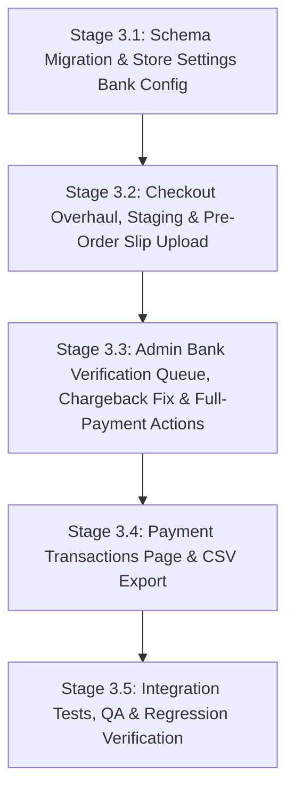

# DSL Stationery — Admin Phase 1, Stage 3: Implementation Roadmap & Effort Estimation (Final Architectural Alignment)

**Document ID:** `ROADMAP-ADMIN-PHASE1-STAGE3-005`  
**Revision Date:** 2026-11-14  
**Scope:** Three supported methods, mandatory pre-order receipt upload, dual-entity payment model, upload/order atomicity, superseding evidence history, chargeback dispute exclusion, state machine alignment, Koko removal vs DB retention, safe schema migration, phased deliverables, and complexity estimates  
**Guiding Principle:** **Disciplined Phased Execution with Strict Financial, Deletion, and Privacy Safeguards**  

---

## 1. Feature Status Categorization

Every capability within the Stage 3 scope is categorized against the confirmed business rules and architectural reconciliation:

| Capability | Category | Notes & Action |
| :--- | :---: | :--- |
| **PayHere Server Hash & Webhook Validation** | **Already Implemented** | Fully verified; secure checksum validation operational. |
| **PayHere Late-Payment Stock Protection** | **Already Implemented** | Fully verified; checks active reservations and preserves inventory safety. |
| **PayHere Chargeback Dispute Preservation** | **Improvement Required** | Update `handlePayHereWebhook()`: Preserve `PaymentAttempt.status = SUCCEEDED`; record dispute in `gatewayPayload.dispute` and `OrderAuditLog`; deduct from `calculateRefundableBalance()`. |
| **Financial Reconciliation Dashboard** | **Already Implemented** | Reused directly from Stage 2 (`/admin/reconciliation`); filters updated to omit Koko. |
| **Stage 2 Refund Engine & SoD Guards** | **Already Implemented** | `calculateRefundableBalance()` and dual-custody approval/completion segregation preserved. |
| **COD Delivery & Collection Flow** | **Already Implemented** | Delivery status tracking functional; refunds correctly blocked until marked delivered. |
| **Bank Transfer Initial Payment Status** | **Partially Implemented (Defective)** | **Fix Required:** Change `CheckoutService.processPayment()` to initialize with `paymentStatus: PENDING` and `PaymentAttempt.status: PROCESSING` (never `PAID`). |
| **Admin Store Settings Bank Details** | **Missing** | **New Feature:** Add bank configuration fields to `StoreSettings` model and Admin Settings UI. |
| **Mandatory Pre-Order Slip Upload** | **Missing** | **New Feature:** Customer must enter reference, date, and upload slip at checkout before placing order. |
| **Private Receipt Storage & Auth Stream** | **Missing** | **New Feature:** Store in `/storage/private/payment-receipts/`; stream via authenticated API endpoint with role-based checks. |
| **Upload/Order Staging & Atomic Promotion** | **Missing** | **New Feature:** Temporary upload staging (`/storage/private/temp-receipts/`), atomic promotion upon order placement, and automated cron purge. |
| **Bank Submission Model (`onDelete: Restrict`)** | **Missing** | **Schema Migration:** Create `BankDepositSubmission` model with non-destructive retention and link to `PaymentAttempt`. |
| **Evidence Superseding History** | **Missing** | **New Feature:** When customer resubmits rejected slip, prior submission transitions to `SUPERSEDED`, preserving reviewer, timestamp, and rejection reason. |
| **Duplicate Order Prevention (Idempotency)** | **Missing** | **New Feature:** Deterministic idempotency key (`order-bt-${reservationId}-${uploadToken}`) and reservation lock to prevent double submissions. |
| **Admin Pending Bank Verification Queue** | **Missing** | **New Feature:** Dedicated queue to review uploaded receipts, bank statement references, and deposit dates. |
| **Full-Payment-Only Bank Verification API** | **Missing** | **New Feature:** Backend API validating full amount equality (`confirmedAmountCents === order.totalCents`) and unique bank reference. |
| **Payment Transactions Page (`/admin/payments`)** | **Missing** | **New Feature:** Admin dashboard for all `PaymentAttempt` records, search, filters, and transaction details drawer. |
| **Payment Transactions CSV Export** | **Missing** | **New Feature:** Streaming CSV export for accounting and financial auditing. |
| **Koko BNPL Codebase Removal** | **Recommended Cleanup** | Remove Koko from frontend dropdowns and enforce API boundary rejection; retain enum in DB for historical safety. |
| **Automated Courier Cash Remittance** | **Blocked by External Dependency** | Requires third-party courier webhook/API agreements (Domex/Pronto); manual marking remains standard. |
| **Automated PayHere Refund API** | **Not Required** | Manual merchant portal processing with recorded references is verified and sufficient. |

---

## 2. Koko Removal Scope & Sequencing

DSL Stationery supports **only Card, Bank Transfer, and COD**. Koko removal will follow this disciplined sequence:

1. **Frontend Dropdown Clean-Up:** Remove `<option value="KOKO_BNPL">` from `/admin/reconciliation` and `OrderTable` filter selectors.
2. **Modal Clean-Up:** Remove Koko warning banners from `CancelOrderModal`, `CreateRefundModal`, and `RefundManagementCard`.
3. **Backend API Guard:** In checkout and refund controllers, explicitly reject any request containing `paymentMethod: 'KOKO_BNPL'` with `400 Bad Request` (*"Payment method not supported"*).
4. **Database Enum Retention:** Keep the enum value `KOKO_BNPL` in PostgreSQL DDL to avoid breaking historical records on existing databases. No active business logic will treat Koko as a supported method.

---

## 3. Phased Implementation Roadmap

We structure Stage 3 execution into **five cohesive, sequentially verifiable sub-phases**:

### Stage 3.1: Schema Migration & Store Settings Bank Configuration
- **Deliverables:**
  1. Add bank configuration fields to `StoreSettings` in `schema.prisma` (`bankTransferEnabled`, `bankName`, `accountNumber`, `accountName`, `branchName`, `swiftCode`, `instructions`).
  2. Add `BankDepositSubmission` model in `schema.prisma` with `onDelete: Restrict` on `Order` and foreign key reference to `PaymentAttempt`.
  3. Add `BankDepositStatus` enum (`PENDING`, `VERIFIED`, `REJECTED`, `SUPERSEDED`).
  4. Apply migration strictly to isolated `dsl_stationery_test` (`npx prisma db push`).
  5. Implement `GET /api/v1/store-settings/public` (returns sanitized bank details for checkout).
  6. Implement `PUT /api/v1/admin/store-settings/bank-transfer` (restricted to `SUPER_ADMIN`).
  7. Build Bank Transfer configuration form in `frontend/src/app/admin/settings/page.tsx` with field validation and toggle controls.
- **Complexity:** **Low to Medium** (1 developer day).

### Stage 3.2: Checkout Overhaul, Staging & Mandatory Pre-Order Bank Slip Upload
- **Deliverables:**
  1. Fix `CheckoutService.processPayment()`:
     - Bank Transfer orders require valid receipt staging token and transaction reference.
     - Initializes order with `orderStatus: PENDING` and `paymentStatus: PENDING`.
     - Initializes `PaymentAttempt` with `status: PROCESSING`.
     - Promotes staged receipt from `/storage/private/temp-receipts/` to `/storage/private/payment-receipts/` within DB transaction.
     - Creates initial `BankDepositSubmission(status: PENDING)`.
  2. Implement client idempotency guard in `CheckoutService`:
     - Computes deterministic key: `order-bt-${reservationId}-${uploadToken}`.
     - Rejects duplicate calls if `StockReservation` is already `CONSUMED`.
  3. Implement private storage and staging service:
     - Staging path: `/storage/private/temp-receipts/<token>.<ext>`.
     - Final path: `/storage/private/payment-receipts/<uuid>.<ext>`.
     - Enforces magic-byte mime inspection (JPEG, PNG, WebP, PDF only) and 10MB size limit.
  4. Implement pre-order receipt upload staging API:
     - `POST /api/v1/checkout/bank-receipt-upload`.
     - Returns `{ uploadToken, originalFilename, fileSize, expiresAt }`.
  5. Implement automated temporary upload cleanup cron:
     - Hourly purge of unpromoted files in `/storage/private/temp-receipts/` older than 2 hours.
  6. Implement customer resubmission API:
     - `POST /api/v1/orders/:id/payment-evidence` (for orders where prior submission was `REJECTED`).
     - Transitions prior submission from `REJECTED` to `SUPERSEDED` (preserving reviewer ID, rejection reason, and timestamp).
     - Creates new submission with `status: PENDING`.
  7. Implement authenticated file stream API:
     - `GET /api/v1/orders/:orderId/payment-evidence/:submissionId/file`.
     - Verifies user ownership or Admin role (`SUPER_ADMIN`, `ADMIN`).
     - Streams file with `Content-Disposition: inline` and anti-sniffing headers.
  8. Update customer checkout page (`/checkout`):
     - Dynamically renders Bank Transfer with live bank details from store settings.
     - Form includes reference input, deposit date picker, and file uploader.
     - **Place Order button strictly disabled until valid slip is uploaded and required fields are populated.**
  9. Update customer order tracking view (`/orders/track`):
     - Displays bank verification status banner ("Pending Verification", "Verified", or "Rejected").
     - Shows explicit rejection reason and resubmission form when status is `REJECTED`.
- **Complexity:** **Medium** (1.5 developer days).

### Stage 3.3: Admin Bank Verification Queue, Chargeback Correction & Full-Payment Actions
- **Deliverables:**
  1. Correct PayHere chargeback handling in `CheckoutService.handlePayHereWebhook()`:
     - Preserve `PaymentAttempt.status = SUCCEEDED`.
     - Record dispute in `gatewayPayload.dispute` and log `OrderAuditLog(CHARGEBACK_RECEIVED)`.
     - In `calculateRefundableBalance()`, deduct `disputedFundsCents` from refundable balance.
  2. Implement `GET /api/v1/admin/payments/bank-verifications` (pending verification queue with pagination, date filters, and search).
  3. Implement `POST /api/v1/admin/payments/bank/:submissionId/verify`:
     - Row-level lock (`FOR UPDATE`) on `Order`.
     - Validates that `BankDepositSubmission.status === PENDING`.
     - Unique reference validation across all `PaymentAttempt` records (`gatewayReference`).
     - Full-payment-only validation (`confirmedAmountCents === order.totalCents`).
     - Updates `BankDepositSubmission` to `VERIFIED` with `reviewedById` and `reviewedAt`.
     - Updates `PaymentAttempt` to `SUCCEEDED` with `gatewayReference = verifiedReference`.
     - Updates `Order`: `paymentStatus: PAID`, `orderStatus: PROCESSING`.
     - Writes `OrderAuditLog(BANK_DEPOSIT_VERIFIED)`.
  4. Implement `POST /api/v1/admin/payments/bank/:submissionId/reject`:
     - Updates `BankDepositSubmission` to `REJECTED` with mandatory rejection reason, `reviewedById`, and `reviewedAt`.
     - Leaves `Order.paymentStatus = PENDING`.
     - Writes `OrderAuditLog(BANK_RECEIPT_REJECTED)`.
  5. Build `VerifyBankDepositModal.tsx` on order details and pending verification queue.
  6. Reconcile order state machine: ensure no illegal transitions (e.g. `CONFIRMED` -> `PENDING` is strictly disallowed; pre-pay card failures cancel reservation directly without creating an order).
- **Complexity:** **Medium** (1.5 developer days).

### Stage 3.4: Payment Transactions Admin Page & CSV Export
- **Deliverables:**
  1. Implement `GET /api/v1/admin/payments`:
     - Pagination, filters (method, status, date range), and search (by reference, order number, customer email).
     - Support filtering unlinked or orphaned attempts.
  2. Implement `GET /api/v1/admin/payments/:id`:
     - Sanitized projection of gateway payloads, masking raw signatures and sensitive credentials.
     - Linked order details, refund history, and bank deposit submissions.
  3. Implement `GET /api/v1/admin/payments/export`:
     - Streamed CSV export with standard accounting headers: `Payment ID`, `Order Number`, `Method`, `Status`, `Amount (LKR)`, `Fee (LKR)`, `Net (LKR)`, `Reference`, `Date`.
  4. Build `/admin/payments/page.tsx`:
     - KPI cards (Total Volume, Successful Collections, Pending Bank Verifications, Failed Attempts).
     - Filter toolbar (method, status, date picker, search input).
     - Data table with status badges and quick view actions.
  5. Build `PaymentDetailsDrawer.tsx` (slide-over drawer with raw attempt timeline, linked order link, and payload inspector).
  6. Add "Payment Operations" navigation link in `AdminSidebar.tsx`.
- **Complexity:** **Medium** (1.5 developer days).

### Stage 3.5: Integration Testing, QA & Final Sign-Off
- **Deliverables:**
  1. Backend unit tests in `admin-payments.service.spec.ts` (15+ tests covering verification, rejection, idempotency, and reference collision).
  2. PostgreSQL integration tests on `dsl_stationery_test`:
     - **Test P-1 (Bank Checkout & Pre-Order Upload):** Verify order creation requires slip token, creates `PENDING` order, `PROCESSING` attempt, and `PENDING` submission.
     - **Test P-2 (Duplicate Reference Collision):** Verify rejection when verifying with an already used bank reference.
     - **Test P-3 (Customer Resubmission & History Preservation):** Verify rejected submission transitions to `SUPERSEDED` upon new upload, with prior reason and reviewer intact.
     - **Test P-4 (Full-Payment-Only Enforcement):** Verify rejection when verification amount does not match `order.totalCents`.
     - **Test P-5 (Chargeback Preservation & Refund Guard):** Verify PayHere chargeback preserves `SUCCEEDED` status and prevents subsequent refund disbursement.
     - **Test P-6 (Deletion Safety):** Verify `onDelete: Restrict` prevents accidental deletion of orders with attached bank submissions.
  3. Full regression execution:
     - Stage 1 suite (104 tests passed).
     - Stage 2 suite (148 tests passed).
  4. Development database safety verification:
     - Confirm `dsl_stationery` remains 100% untouched (`Double Submission Test Product` stock = 10, total orders = 2, total refunds = 0).
- **Complexity:** **Medium** (1 developer day).

---

## 4. Technical Complexity & Effort Matrix

| Phase | Description | Complexity | Est. Effort | Risk Level |
| :--- | :--- | :---: | :---: | :---: |
| **Stage 3.1** | Schema evolution on test DB & Store Settings bank config | **Low** | 1 day | Low |
| **Stage 3.2** | Checkout overhaul, staging, pre-order slip upload & private storage | **Medium** | 1.5 days | Low |
| **Stage 3.3** | Admin verification queue, full-payment check & chargeback fix | **Medium** | 1.5 days | Medium (Financial state) |
| **Stage 3.4** | `/admin/payments` dashboard, details drawer & CSV export | **Medium** | 1.5 days | Low |
| **Stage 3.5** | Testing, PostgreSQL integration & regression audit | **Medium** | 1 day | Zero |
| **TOTAL** | Complete Stage 3 Payment Operations | **Overall: Medium** | **~6.5 days** | **Managed Risk** |

---

## 5. Architectural Alignment Checklist

All seven required architectural resolutions are formally tracked and validated across the 4 Stage 3 documents:

- [x] **1. PayHere Chargebacks:** Preserves original `SUCCEEDED` attempt status and `PAID` payment history; excludes disputed funds from `calculateRefundableBalance()`.
- [x] **2. Dual-Entity Model:** Non-redundant separation between `PaymentAttempt` (universal financial ledger) and `BankDepositSubmission` (operational evidence and review history).
- [x] **3. Rejected Evidence History:** Status transitions to `SUPERSEDED` upon resubmission; reviewer, timestamp, and rejection reason remain permanently immutable.
- [x] **4. Upload/Order Atomicity:** Staging in `/temp-receipts/`, atomic promotion to `/payment-receipts/` inside database transaction, and hourly automated cleanup cron.
- [x] **5. Duplicate Order Prevention:** Deterministic idempotency key (`order-bt-${reservationId}-${uploadToken}`) and reservation locking prevent duplicate orders.
- [x] **6. Order State Machine Reconciliation:** Strict compliance with `PERMITTED_STATUS_TRANSITIONS`; eliminates invalid `CONFIRMED -> PENDING` transitions; pre-pay card failures release stock without creating orders.
- [x] **7. Document Consistency:** Exact alignment across Audit, Gap Analysis, Technical Architecture, and Implementation Roadmap (`005` revision).

---

## 6. Final Recommendation on Stage 3 Implementation

### **RECOMMENDATION: YES — PROCEED WITH IMPLEMENTATION**

**Justification:**
1. **Critical Financial Correction:** Eliminates the defect where bank transfer orders were marked `PAID` without verifying receipt of money.
2. **Guaranteed Deposit Evidence:** Enforcing mandatory pre-order slip upload guarantees that every Bank Transfer order in the database has customer evidence attached upon creation.
3. **Safe Retention & Non-Destructive Deletion:** Protects financial records with `onDelete: Restrict`, ensuring receipts and verification audits can never be accidentally erased.
4. **Private Evidence Storage:** Replaces insecure static file paths with private, authenticated storage and magic-byte inspection.
5. **Accounting Integrity:** Fixes PayHere chargeback handling so historical collection ledgers remain authentic.

---

## 7. Stop Condition

All four Stage 3 planning documents have been comprehensively revised, aligned, and saved:
1. `docs/admin-phase-1-stage-3-payment-operations-audit.md` (Version: `005`)
2. `docs/admin-phase-1-stage-3-gap-analysis.md` (Version: `005`)
3. `docs/admin-phase-1-stage-3-technical-architecture.md` (Version: `005`)
4. `docs/admin-phase-1-stage-3-implementation-roadmap.md` (Version: `005`)

**STOPPED: Awaiting explicit human approval before any implementation code or schema migrations are executed.**
