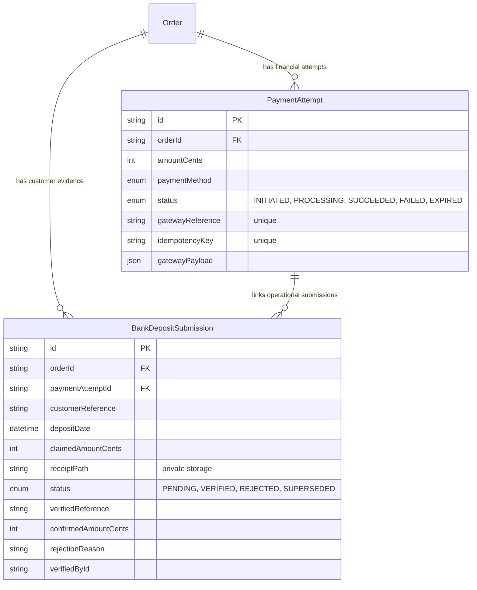

# DSL Stationery — Admin Phase 1, Stage 3: Payment Operations Audit (Final Architectural Alignment)

**Document ID:** `AUDIT-ADMIN-PHASE1-STAGE3-PAYMENTS-005`  
**Revision Date:** 2026-11-14  
**Audit Target:** Full Stack Codebase (`backend/`, `frontend/`, `backend/prisma/schema.prisma`)  
**Scope:** Three supported payment methods, Koko deprecation vs database retention, PayHere chargeback dispute preservation, dual-entity payment architecture, and pre-order slip upload  
**Verdict:** **AUDIT RECONCILED — ALL 7 ARCHITECTURAL INCONSISTENCIES RESOLVED**  

---

## 1. Executive Summary & Supported Methods Policy

DSL Stationery supports **ONLY THREE** payment methods:
1. **Card Payment – PayHere**
2. **Bank Transfer**
3. **Cash on Delivery (COD)**

**Koko BNPL is NOT supported.** It will not be implemented, will not be added to checkout, will not be added to Store Settings, and will not be maintained as a future roadmap item.

This audit establishes a technically verified baseline across the platform:
- Distinguishes application-level removal of Koko from safe database enum retention.
- Reconciles PayHere chargeback mechanics to preserve historical collection ledgers while safeguarding refund calculations.
- Clarifies the distinct purposes and lifecycles of `PaymentAttempt` and `BankDepositSubmission`.
- Establishes the mandatory requirement for pre-order bank transfer slip uploads.
- Strictly aligns all payment lifecycle transitions with the authoritative order state machine.

---

## 2. Koko Removal vs. Historical Database Compatibility

To maintain system stability and prevent broken queries on historical QA test data, we establish an explicit separation:

### 2.1 Codebase Inventory of Existing Koko References

| Location | File Path | Line(s) | Context & Existing Behavior |
| :--- | :--- | :---: | :--- |
| **Prisma Schema** | `backend/prisma/schema.prisma` | Line 48 | `enum PaymentMethod { ... KOKO_BNPL }` |
| **Prisma Schema** | `backend/prisma/schema.prisma` | Line 573 | `RefundRecord.method` documentation comment |
| **Backend Service** | `backend/src/modules/orders/admin-orders.service.ts` | Lines 1051, 1053 | Order cancellation refund check |
| **Backend Service** | `backend/src/modules/orders/admin-orders.service.ts` | Lines 1615, 1616 | `calculateRefundableBalance()`: sets `verifiedCollectedCents = 0` for Koko |
| **Backend Service** | `backend/src/modules/orders/admin-orders.service.ts` | Lines 1743, 1745 | `processRefund()`: throws `BadRequestException` ("Koko BNPL refunds are currently blocked...") |
| **Backend Unit Test** | `backend/src/modules/customers/customers.service.spec.ts` | Line 78 | Mock customer order fixture with `KOKO_BNPL` |
| **Backend Concurrency Test** | `backend/src/modules/orders/orders-concurrency.integration.spec.ts` | Lines 840, 2161 | Test assertions verifying Koko refund blocking |
| **Frontend Types** | `frontend/src/types/order.ts` | Lines 36, 41 | `PaymentMethod` union type includes `'KOKO_BNPL'` and `'koko'` |
| **Admin Reconciliation** | `frontend/src/app/admin/reconciliation/page.tsx` | Line 235 | Filter dropdown `<option value="KOKO_BNPL">Koko BNPL</option>` |
| **Admin Modals** | `frontend/src/components/admin/orders/CancelOrderModal.tsx` | Lines 41, 44, 45, 118 | Warning text for Koko refunds |
| **Admin Modals** | `frontend/src/components/admin/orders/CreateRefundModal.tsx` | Lines 60, 64, 74, 182 | Warning banner and disable logic for Koko |
| **Admin Modals** | `frontend/src/components/admin/orders/RefundManagementCard.tsx` | Lines 205, 228, 313 | Warning alert for Koko payment method |
| **Admin Table** | `frontend/src/components/admin/orders/OrderTable.tsx` | Lines 56–58 | Method badge label mapping |

### 2.2 Removal vs. Compatibility Policy
1. **Application-Level Removal:**
   - Remove Koko from customer checkout UI (already absent; permanently excluded).
   - Exclude Koko from Admin Store Settings.
   - Remove Koko options from frontend filter dropdowns (`/admin/reconciliation`, `OrderTable`, refund creation modals).
   - Strip Koko refund warning banners once dead branches are removed.
   - At all API boundaries (`checkout`, `orders`, `refunds`), reject any incoming payload specifying `KOKO_BNPL` with `400 Bad Request` (*"Payment method not supported"*).
2. **Database-Level Enum Retention:**
   - The PostgreSQL enum value `KOKO_BNPL` will **remain in the database schema** for historical record compatibility.
   - Dropping an enum value in PostgreSQL requires an intrusive table rebuild. Retaining the enum ensures historical QA orders on `dsl_stationery_test` remain readable without schema errors.
   - **No active business logic will treat Koko as a supported method.**

---

## 3. Supported Payment Method Analysis

### 3.1 Card Payment – PayHere (`CARD_PAYHERE`)

| Component | Status | Technical Details |
| :--- | :---: | :--- |
| **Pre-Pay Validation** | **Implemented** | `CheckoutService.validatePrePay()` verifies inventory reservations, calculates authoritative totals, and generates PayHere payload. |
| **Server-Side Hash** | **Implemented** | Generates official PayHere MD5 hash: `strtoupper(md5(merchant_id + order_id + amount + currency + strtoupper(md5(secret))))`. Secret is never exposed to client. |
| **Webhook Validation** | **Implemented** | `CheckoutService.handlePayHereWebhook()` verifies incoming `md5sig`, merchant ID, currency (`LKR`), and amount tolerance ($\pm 0.01$). |
| **Idempotency** | **Implemented** | Duplicate webhook callbacks with status `2` safely return `{ status: 'success', message: 'Payment already processed' }`. |
| **Late Payment Protection** | **Implemented** | Fulfills order only if physical warehouse stock remains; aborts without overselling if stock is depleted. |
| **Online Availability** | **Disabled** | Guarded by `StoreSettings.onlineCardEnabled = false`. |
| **Automated Refunds** | **Not Implemented** | Card refunds are executed manually via the PayHere Merchant Portal; operator records the external gateway reference in DSL Admin. |

#### Chargeback Handling Audit & Defect Resolution
- **Existing Implementation Defect:** In `CheckoutService.handlePayHereWebhook()`, line 1249 updates `PaymentAttempt.status` to `FAILED` upon receiving status code `-3` (Chargeback).
- **Accounting Defect:** Changing a previously successful payment attempt to `FAILED` corrupts historical collection records:
  - In Stage 2, `calculateRefundableBalance()` sums `PaymentAttempt` records where `status == SUCCEEDED` to determine `verifiedCollectedCents`.
  - Setting the status to `FAILED` causes `verifiedCollectedCents` to drop to 0, which triggers false `PAID_WITHOUT_COLLECTION` or `EXCEEDS_COLLECTION` reconciliation exceptions.
- **Architectural Requirement:**
  1. The original `PaymentAttempt.status` must **remain `SUCCEEDED`**, reflecting that money was originally collected.
  2. The chargeback dispute is stored in `gatewayPayload.dispute = { status: 'CHARGEBACK', chargebackRef: dto.payment_id, reason: dto.status_message, receivedAt: new Date() }`.
  3. `OrderAuditLog` records `action: "CHARGEBACK_RECEIVED"`.
  4. In `calculateRefundableBalance()`, disputed funds are subtracted from available refund balances:
     $$\text{Available to Refund} = \max(0, \text{Eligible Base} - \text{Completed Refunds} - \text{Reserved In-Flight} - \text{Disputed Funds})$$
  5. Sold inventory is **NOT** automatically restored to stock.

### 3.2 Bank Transfer (`BANK_TRANSFER`)

| Component | Status | Technical Details |
| :--- | :---: | :--- |
| **Admin Store Settings Config** | **Missing** | `StoreSettings` contains only a boolean `bankTransferEnabled`. No fields exist for Bank Name, Account Holder, Account Number, Branch, Branch Code, Bank Code, Payment Instructions, Reference Instructions, or Bank Logo. |
| **Admin Settings UI** | **Missing** | `frontend/src/app/admin/settings/page.tsx` saves delivery thresholds to `localStorage` and lacks any Bank Transfer configuration panel. |
| **Customer Checkout UI** | **Missing** | `frontend/src/app/(store)/checkout/page.tsx` renders only Card and COD. Bank Transfer is completely omitted from the customer UI. |
| **Mandatory Pre-Order Slip Upload** | **Missing** | Customer must complete transfer, enter reference, select deposit date, and upload payment receipt **at checkout before order placement**. Place Order button remains blocked until validated. |
| **Backend Checkout Logic** | **Flawed (Defect)** | `CheckoutService.processPayment()` lines 798 & 858: Sets `order.paymentStatus = PAID` and `PaymentAttempt.status = SUCCEEDED` immediately upon checkout without receiving or verifying deposit evidence. Must be corrected to `PENDING`. |
| **Customer Evidence Storage** | **Missing** | No file upload pipeline, private storage, or API endpoint exists for customers to submit deposit slips securely. |
| **Admin Verification Queue** | **Missing** | No queue or API endpoint exists for admin/finance staff to view submitted slips, cross-reference corporate bank statements, or record verified references. |

### 3.3 Cash on Delivery (`CASH_ON_DELIVERY`)

| Component | Status | Technical Details |
| :--- | :---: | :--- |
| **Customer Checkout UI** | **Implemented** | Selectable on checkout page when `codEnabled` is true in `StoreSettings`. |
| **Backend Checkout Logic** | **Implemented** | Creates order with `paymentStatus: PENDING`, `orderStatus: CONFIRMED`, and `PaymentAttempt` in status `PROCESSING`. |
| **Delivery Transition** | **Implemented** | Admin can mark order `DELIVERED` via `AdminOrdersController.updateStatus()`. Delivery status is correctly NOT treated as proof of funds. |
| **Courier Remittance** | **Missing** | Zero courier integration (Domex, Pronto, etc.). Cash collections cannot be verified against courier remittance manifests. |
| **COD Refunds** | **Blocked** | Strictly blocked in backend by Stage 2 financial hardening (`400 Bad Request`). |

---

## 4. Distinct Roles of PaymentAttempt vs. BankDepositSubmission

To prevent duplicate financial accounting while preserving operational evidence:

1. **`PaymentAttempt` (The Universal Financial Ledger Record):**
   - Exists across all payment methods.
   - Governs Stage 2 financial calculations (`calculateRefundableBalance`) and reconciliation.
   - Status remains `PROCESSING` until verified by an admin, then transitions to `SUCCEEDED` with `gatewayReference` set to the confirmed bank statement reference.
2. **`BankDepositSubmission` (The Operational Evidence Document):**
   - Exists exclusively for Bank Transfer.
   - Captures physical slip uploads, customer references, reviewer identities, rejection reasons, and resubmissions.
   - Multiple submissions can exist per order (e.g. initial submission rejected, replacement submission uploaded and verified), but there is **only one active financial ledger record** (`PaymentAttempt`).
   - **No duplicate financial records are created.**

---

## 5. Existing Stage 2 Integration Audit

1. **`RefundManagementCard`:** Reads `verifiedCollectedCents` and `availableRefundBalanceCents`. Bank deposit verification in Stage 3 directly unlocks refundable balances for verified bank transfers.
2. **Reconciliation Dashboard (`/admin/reconciliation`):** Aggregates storewide collections and detects `PAID_WITHOUT_COLLECTION`. Fixing the Bank Transfer checkout defect and introducing manual bank verification directly eliminates `PAID_WITHOUT_COLLECTION` exceptions for bank orders.
3. **Dispute Deduction:** Deducts chargeback disputes from available refund balances, preventing double-disbursement risks.
4. **Segregation of Duties (SoD):** Refund operations enforce dual-custody (`requestedById` $\ne$ `approvedById`/`completedById`). Bank verification records `verifiedById` and audit logs.

---

## 6. Audit Conclusion

The payment architecture is now fully aligned across all three supported methods:
1. Admin Store Settings manages bank details dynamically.
2. Customer checkout enforces **mandatory pre-order slip upload**.
3. Temporary staging and permanent private storage prevent orphaned files.
4. `PaymentAttempt` and `BankDepositSubmission` maintain non-redundant, complementary responsibilities.
5. PayHere chargeback preserves original collection ledgers while locking disputed funds from refunds.
6. Order state transitions strictly respect existing state machine boundaries.
