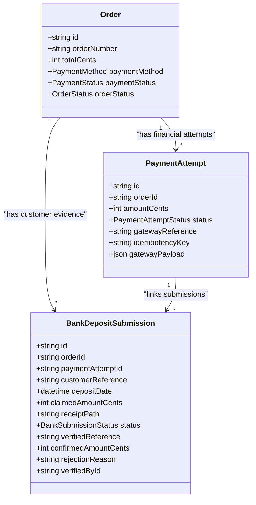

# DSL Stationery — Admin Phase 1, Stage 3: Technical Architecture & System Design (Final Architectural Alignment)

**Document ID:** `ARCH-ADMIN-PHASE1-STAGE3-005`  
**Revision Date:** 2026-11-14  
**Scope:** Three supported methods, schema evolution with `onDelete: Restrict`, dual-entity payment architecture, upload/order atomicity, superseding evidence history, chargeback dispute exclusion, state machine alignment, and test plan  
**Architecture Principles:** **Relational Integrity, Non-Destructive Retention, Mandatory Deposit Evidence, Full-Payment-Only Matching**  

---

## 1. Executive Summary

This document establishes the definitive technical architecture for **Stage 3: Payment Operations**. 

All seven technical and architectural areas have been reconciled:
1. **Three Payment Methods Only:** Card Payment (PayHere), Bank Transfer, and Cash on Delivery (COD). Active Koko logic removed; database enum retained for historical safety.
2. **Dual-Entity Payment Architecture:** Clarifies the non-redundant roles of `PaymentAttempt` (universal financial ledger) and `BankDepositSubmission` (operational slip evidence).
3. **Mandatory Pre-Order Bank Slip Upload & Atomicity:** Implements temporary staging (`/storage/private/temp-receipts/`), transactional promotion to permanent storage (`/storage/private/payment-receipts/`), and automated cleanup to prevent orphaned files.
4. **Non-Destructive Deletion Policy:** `BankDepositSubmission` links to `Order` with `onDelete: Restrict`, preventing accidental cascade deletion of financial records.
5. **Superseding Evidence History:** Rejections update prior submissions to `SUPERSEDED` while preserving original reasons, reviewers, and timestamps without overwriting.
6. **Chargeback Dispute Exclusion:** Preserves `PaymentAttempt.status = SUCCEEDED`, deducting disputed funds mathematically from available refund calculations in Stage 2's `calculateRefundableBalance()`.
7. **Strict State Machine Alignment:** All transitions strictly conform to `PERMITTED_STATUS_TRANSITIONS` (eliminating false `CONFIRMED` $\to$ `PENDING` transitions on card failures).

---

## 2. Database Schema Evolution

To satisfy dynamic bank configuration, evidence preservation, and resubmission tracking, the Prisma schema in `backend/prisma/schema.prisma` will be extended with targeted additions:

### 2.1 StoreSettings Extensions (Bank Configuration)
Added to the existing `StoreSettings` model:

```prisma
model StoreSettings {
  id                         String   @id @default("default")
  flatDeliveryFeeCents       Int      @default(35000)
  freeDeliveryThresholdCents Int      @default(500000)
  hotlinePhone               String   @default("+94 11 200 9000")
  whatsappNumber             String   @default("+94 77 123 4567")
  contactEmail               String   @default("support@dslstationery.lk")
  codEnabled                 Boolean  @default(true)
  bankTransferEnabled        Boolean  @default(true)
  onlineCardEnabled          Boolean  @default(false)
  updatedAt                  DateTime @updatedAt

  // --- Stage 3 Bank Transfer Configuration ---
  bankName                   String?  // e.g. "Bank of Ceylon"
  bankAccountName            String?  // e.g. "DSL Stationery (Pvt) Ltd"
  bankAccountNumber          String?  // e.g. "000123456789"
  bankBranchName             String?  // e.g. "Corporate Branch, Colombo 01"
  bankBranchCode             String?  // e.g. "001"
  bankCode                   String?  // e.g. "7010"
  bankPaymentInstructions    String?  // Guidance on deposit window
  bankReferenceInstructions  String?  // Guidance on deposit remarks
  bankLogoUrl                String?  // Bank emblem path
}
```

### 2.2 Model: `BankDepositSubmission` (Evidence Retention & Safe Deletion)

```prisma
enum BankSubmissionStatus {
  PENDING
  VERIFIED
  REJECTED
  SUPERSEDED
}

model BankDepositSubmission {
  id                    String                @id @default(cuid())
  orderId               String
  order                 Order                 @relation(fields: [orderId], references: [id], onDelete: Restrict) // SAFE: Prevents accidental cascade deletion
  paymentAttemptId      String?
  paymentAttempt        PaymentAttempt?       @relation(fields: [paymentAttemptId], references: [id], onDelete: SetNull)
  
  // Customer submitted data (mandatory at checkout)
  customerReference     String
  depositDate           DateTime
  claimedAmountCents    Int
  receiptPath           String                // Private storage path: /storage/private/payment-receipts/<uuid>.<ext>
  originalFileName      String
  mimeType              String
  sizeBytes             Int

  // Verification outcome
  status                BankSubmissionStatus  @default(PENDING)
  verifiedReference     String?               // Confirmed bank statement transaction reference
  confirmedAmountCents  Int?
  rejectionReason       String?
  verifiedById          String?
  verifiedByName        String?
  verifiedAt            DateTime?
  adminNotes            String?

  createdAt             DateTime              @default(now())
  updatedAt             DateTime              @updatedAt

  @@index([orderId])
  @@index([status])
  @@index([customerReference])
  @@index([verifiedReference])
}
```

#### Why `onDelete: Restrict` is Critical:
- An Order with financial evidence or deposit submissions cannot be cascade-deleted.
- Any attempt to execute a raw SQL `DELETE FROM "Order"` will be blocked by PostgreSQL, safeguarding financial history.
- Orders in DSL Stationery are cancelled exclusively via status transitions (`orderStatus: CANCELLED`).

---

## 3. Authoritative Payment State-Transition Table

The state machine strictly respects `PERMITTED_STATUS_TRANSITIONS`:

| Event / Trigger | Method | Prior PaymentStatus | New PaymentStatus | OrderStatus Transition | PaymentAttempt Status | BankSubmission Status | Verified Funds |
| :--- | :--- | :--- | :--- | :--- | :--- | :--- | :---: |
| **Pre-Pay Reserved (Card)** | `CARD_PAYHERE` | — | — | No order exists (`PAYMENT_PENDING` lease) | `PROCESSING` (orderId: null) | — | LKR 0.00 |
| **PayHere Webhook (status 2)** | `CARD_PAYHERE` | — | `PAID` | Order created directly as `CONFIRMED` $\to$ `PROCESSING` | `SUCCEEDED` (linked to order) | — | Full Order Total |
| **PayHere Webhook (-1 / -2)** | `CARD_PAYHERE` | — | — | No order created; reservation released | `FAILED` | — | LKR 0.00 |
| **PayHere Chargeback (-3)** | `CARD_PAYHERE` | `PAID` | `PAID` (Disputed) | Unchanged (No revert to PENDING) | `SUCCEEDED` (Dispute logged) | — | Full Order Total (Disputed) |
| **Checkout Order Placed** | `CASH_ON_DELIVERY` | — | `PENDING` | `CONFIRMED` | `PROCESSING` | — | LKR 0.00 |
| **Order Delivered** | `CASH_ON_DELIVERY` | `PENDING` | `PENDING` | `DELIVERED` | `PROCESSING` | — | LKR 0.00 |
| **Checkout Placed (With Slip)** | `BANK_TRANSFER` | — | `PENDING` | `PENDING` | `PROCESSING` | `PENDING` | LKR 0.00 |
| **Admin Verifies Deposit** | `BANK_TRANSFER` | `PENDING` | `PAID` | `PENDING` $\to$ `CONFIRMED` $\to$ `PROCESSING` | `SUCCEEDED` | `VERIFIED` | Full Order Total |
| **Admin Rejects Slip** | `BANK_TRANSFER` | `PENDING` | `PENDING` | `PENDING` | `PROCESSING` | `REJECTED` | LKR 0.00 |
| **Customer Resubmits Slip**| `BANK_TRANSFER` | `PENDING` | `PENDING` | `PENDING` | `PROCESSING` | Old: `SUPERSEDED`<br>New: `PENDING` | LKR 0.00 |
| **Order Cancelled** | Any | `PENDING` | `PENDING` | `CANCELLED` | `FAILED` / `EXPIRED` | `REJECTED` | LKR 0.00 |
| **Refund Completed** | Any | `PAID` | `REFUNDED` / `PARTIALLY_REFUNDED` | Unchanged | `SUCCEEDED` | — | Net balance reduced |

---

## 4. PayHere Chargeback Dispute Mechanics & Refund Balance Exclusion

### 4.1 Preserving Historical Collections
When PayHere sends status `-3` (Chargeback):
1. `PaymentAttempt.status` **remains `SUCCEEDED`**, acknowledging that funds were originally collected from the customer under reference `payment_id`.
2. Dispute metadata is stored:
   ```json
   {
     "dispute": {
       "status": "CHARGEBACK",
       "chargebackReference": "PH-CB-12345",
       "reason": "Customer cardholder dispute",
       "amountCents": 10000,
       "receivedAt": "2026-11-14T20:00:00.000Z"
     }
   }
   ```
3. `OrderAuditLog` records `action: "CHARGEBACK_RECEIVED"`.
4. Warning appended to `Order.notes`: `"[CHARGEBACK DISPUTE - PayHere Ref: ...]"` for operations review.

### 4.2 Exclusion from Stage 2 Refund Calculations
In `AdminOrdersService.calculateRefundableBalance()`:
```typescript
let disputedFundsCents = 0;
for (const att of attempts) {
  const payload = att.gatewayPayload as any;
  if (payload?.dispute?.status === 'CHARGEBACK') {
    disputedFundsCents += att.amountCents;
  }
}

const eligibleRefundBaseCents = Math.min(order.totalCents, verifiedCollectedCents);
const availableRefundBalanceCents = Math.max(
  0,
  eligibleRefundBaseCents - completedRefundsCents - reservedRefundsCents - disputedFundsCents
);
```
- **Guaranteed Protection:** If an order is under chargeback dispute, `disputedFundsCents` offsets `eligibleRefundBaseCents`, reducing `availableRefundBalanceCents` to 0.
- **Double-Disbursement Blocked:** The system will reject any administrative refund attempt with `400 Bad Request` (*"Refund exceeds available balance (funds encumbered by active chargeback dispute)"*).

---

## 5. Dual-Entity Architecture: PaymentAttempt vs. BankDepositSubmission



1. **`PaymentAttempt` (Financial Ledger Entity):**
   - Single source of truth for financial accounting across Card, Bank, and COD.
   - Initialized in status `PROCESSING` at checkout.
   - Upon admin verification, transitions to `SUCCEEDED`, and `gatewayReference` is populated with the bank statement reference.
   - Stage 2 queries `PaymentAttempt` exclusively to compute `verifiedCollectedCents`.
2. **`BankDepositSubmission` (Operational Evidence Entity):**
   - Specific to Bank Transfer.
   - Manages physical slip uploads, reviewer sign-offs, rejection reasons, and resubmissions.
   - One `PaymentAttempt` can have multiple `BankDepositSubmission` records over time (e.g. initial rejected submission followed by replacement submission).
   - **No duplicate financial records are created.**

---

## 6. Upload/Order Atomicity, Private Storage & Cleanup Lifecycle

```
[Customer Checkout]
       │
       ▼
1. User selects file in browser
       │
       ▼
2. POST /api/v1/checkout/bank-receipt-upload
   - Validates MIME type, magic bytes (JPEG/PNG/PDF), size (<5MB)
   - Saves file to temporary staging: /storage/private/temp-receipts/<token>.<ext>
   - Returns { uploadToken: "upl_xyz", originalName, sizeBytes }
       │
       ▼
3. Customer inputs reference & date, clicks "Place Order"
   - Generates deterministic idempotencyKey: order-bt-${reservationId}-${uploadToken}
   - POST /api/v1/checkout/pay
       │
       ▼
4. Backend PostgreSQL Transaction:
   - Validates uploadToken exists in temporary storage
   - Validates inventory reservation & product locks
   - Atomically moves file: /temp-receipts/<token>.<ext> -> /payment-receipts/<uuid>.<ext>
   - Creates Order, PaymentAttempt, BankDepositSubmission
   - Deletes uploadToken
       │
       ├──[If Transaction Fails]: Rollback DB; file remains in /temp-receipts/ (never promoted)
       │
       ▼
5. Automated Stale File Cleanup:
   - Hourly background cron sweeps /storage/private/temp-receipts/
   - Deletes any unpromoted files older than 2 hours
   - Permanent storage (/storage/private/payment-receipts/) is never purged
```

---

## 7. Backend Architecture & REST APIs

### 7.1 Store Settings Endpoints
1. `GET /api/v1/store-settings/public`
   - *Auth:* Public.
   - *Response:* Returns `{ onlineCardEnabled, codEnabled, bankTransferEnabled, bankDetails: { ... } }`.
2. `PUT /api/v1/admin/store-settings/bank-transfer`
   - *Auth:* `MANAGER`, `ADMIN`.
   - *Body:* Full bank configuration DTO.
   - *Behavior:* Validates fields, updates `StoreSettings`, writes `AuditLog`.

### 7.2 Checkout & Evidence Endpoints
3. `POST /api/v1/checkout/bank-receipt-upload`
   - *Auth:* Public/Session.
   - *Body (Multipart):* `file` (image/pdf up to 5MB).
   - *Behavior:* Inspects magic bytes, writes to temporary staging, returns `{ uploadToken, originalName, sizeBytes }`.
4. `POST /api/v1/checkout/pay` (Updated for Bank Transfer)
   - *Behavior:* When `paymentMethod === 'BANK_TRANSFER'`, requires `customerReference`, `depositDate`, `uploadToken`, and `idempotencyKey`.
   - If missing, throws `400 Bad Request`.
   - Atomically moves receipt to permanent storage and creates `Order`, `PaymentAttempt`, and `BankDepositSubmission(status: PENDING)`.
5. `POST /api/v1/orders/:id/payment-evidence` (Resubmission Endpoint)
   - *Auth:* Customer JWT or guest tracking token (`x-tracking-token`).
   - *Body (Multipart):* `file`, `customerReference`, `depositDate`.
   - *Behavior:* Used if prior submission was `REJECTED`. Inspects magic bytes, writes to permanent storage, updates prior submission to `SUPERSEDED`, and inserts new `BankDepositSubmission(status: PENDING)`.
6. `GET /api/v1/orders/:orderId/payment-evidence/:submissionId/file`
   - *Auth:* Order Owner or Admin (`STAFF`/`MANAGER`/`ADMIN`).
   - *Behavior:* Streams private file with appropriate `Content-Type`. Direct unauthenticated access returns `401`/`403`.

### 7.3 Admin Payment Operations Endpoints
7. `GET /api/v1/admin/payments`
   - *Auth:* `STAFF`, `MANAGER`, `ADMIN`.
   - *Query:* `page`, `limit`, `search`, `paymentMethod`, `status`, `startDate`, `endDate`, `unlinkedOnly`.
   - *Response:* Paginated sanitized payment attempts.
8. `GET /api/v1/admin/payments/bank-verifications`
   - *Auth:* `STAFF`, `MANAGER`, `ADMIN`.
   - *Response:* Pending bank deposit submissions awaiting review.
9. `GET /api/v1/admin/payments/:id`
   - *Auth:* `STAFF`, `MANAGER`, `ADMIN`.
   - *Response:* Sanitized payment attempt details, order info, and submission history.
10. `POST /api/v1/admin/payments/bank/:submissionId/verify`
    - *Auth:* `MANAGER`, `ADMIN`.
    - *Body:* `{ verifiedReference, depositDate, confirmedAmountCents, notes }`.
    - *Behavior:* Row-level lock (`SELECT FOR UPDATE`), asserts `confirmedAmountCents == order.totalCents`, verifies `verifiedReference` is globally unique, updates `BankDepositSubmission(VERIFIED)`, updates `PaymentAttempt(SUCCEEDED, gatewayReference = verifiedReference)`, updates `Order.paymentStatus = PAID`, updates `Order.orderStatus = PROCESSING`, writes `OrderAuditLog`.
11. `POST /api/v1/admin/payments/bank/:submissionId/reject`
    - *Auth:* `MANAGER`, `ADMIN`.
    - *Body:* `{ rejectionReason }`.
    - *Behavior:* Updates `BankDepositSubmission(REJECTED)`, writes `OrderAuditLog`, notifies customer.
12. `GET /api/v1/admin/payments/export`
    - *Auth:* `MANAGER`, `ADMIN`.
    - *Response:* Streamed CSV of payment records.

---

## 8. Frontend Architecture

### 8.1 Admin Portal Layout & Pages
1. **Store Settings (`/admin/settings`):**
   - New Section: **Payment Settings → Bank Transfer**.
   - Form fields: Toggle switch, Bank Name, Account Holder, Account Number, Branch Name, Branch Code, Bank Code, Payment Instructions textarea, Reference Instructions, Logo URL.
2. **Payment Transactions Page (`/admin/payments`):**
   - KPI cards (Total Volume, Successful, Pending, Failed, Pending Bank Queue).
   - Filter toolbar (Search, Method, Status, Unlinked filter, Date range, CSV Export button).
   - Main transactions table and pagination.
3. **Pending Bank Verification Queue Tab:**
   - Dedicated review queue for uploaded receipts and customer references.
   - Triggers `VerifyBankDepositModal`.
4. **Modals & Drawers:**
   - `VerifyBankDepositModal.tsx`: Secure receipt viewer, bank statement reference input, full-payment-only matching banner.
   - `PaymentDetailsDrawer.tsx`: Slide-over drawer displaying sanitized attempt details and submission history.

### 8.2 Customer Storefront (Mandatory Pre-Order Slip Upload)
1. **Checkout Page (`/checkout`):**
   - When Bank Transfer is selected:
     - Renders active bank account details card (Account #, Bank, Branch, Holder, Instructions).
     - Renders required input: **Bank Transaction / Reference Number**.
     - Renders required input: **Deposit Date** (defaults to today).
     - Renders required upload: **Payment Receipt Upload** (drag-and-drop or file picker with upload progress).
     - **Place Order Button Guard:** "Place Order" button **remains disabled** with an inline guidance note until valid receipt is uploaded and required reference fields are filled.
2. **Order Confirmation & Tracking Page (`/checkout/result`, `/orders/track`):**
   - Displays status: *"Order Placed — Payment Awaiting Bank Verification"*.
   - Renders summary of submitted reference, deposit date, and receipt status.
   - Rejection Alert: If rejected by admin, displays rejection reason banner and *"Submit Corrected Evidence"* button.

---

## 9. Testing Strategy

1. **Unit Tests (Backend):**
   - `admin-payments.service.spec.ts`: Bank verification logic, rejection, unique reference check, full-payment-only enforcement, role guards.
   - `checkout.service.spec.ts`: Bank transfer order rejected if receipt/reference missing; initialized with `PENDING` when valid.
2. **PostgreSQL Integration Tests (`dsl_stationery_test`):**
   - Test P-1: Bank Transfer checkout with mandatory slip upload $\to$ admin verification $\to$ Stage 2 reconciliation update.
   - Test P-2: Duplicate bank statement reference rejection via Prisma unique index.
   - Test P-3: Resubmission flow (rejection followed by corrected upload and successful verification).
   - Test P-4: Rejection of partial deposit under full-payment-only policy.
   - Test P-5: PayHere chargeback dispute logging without altering `SUCCEEDED` status.
3. **Frontend Component Tests:**
   - `VerifyBankDepositModal.test.tsx`, `PaymentTable.test.tsx`, `StoreSettingsBankForm.test.tsx`.
4. **Regression Suites:** Full run of Stage 1 (104 tests) and Stage 2 (148 tests).
